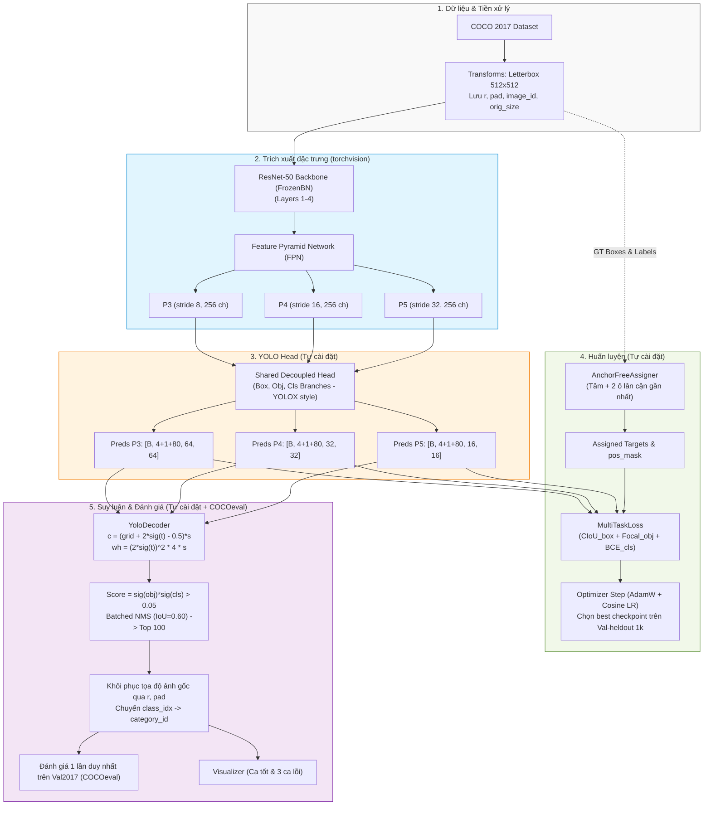
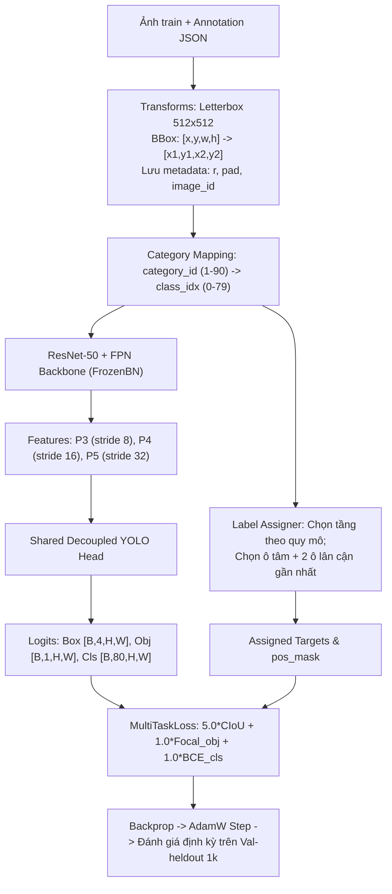
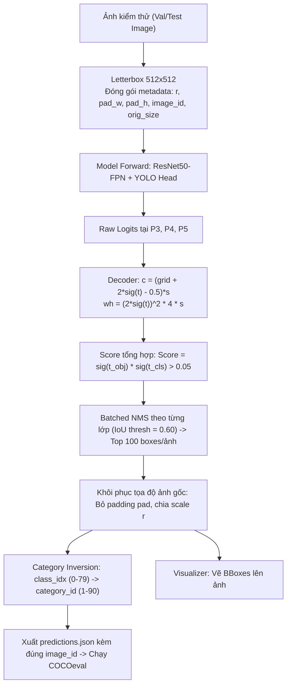

# TÀI LIỆU ĐỊNH NGHĨA VÀ THIẾT KẾ HỆ THỐNG (DEFINE & DESIGN)

* **Dự án:** One-Stage Object Detector (YOLO-style Head trên COCO 2017)
* **Phiên bản tài liệu:** 2.1 (Kiến trúc kỹ thuật chi tiết, đồng bộ công thức & cơ sở lý thuyết chuẩn mực)
* **Giai đoạn:** Thiết kế kỹ thuật trước thực thi (Pre-implementation Design)

---

## BỐI CẢNH VÀ GIẢ ĐỊNH KỸ THUẬT

* **Môi trường thực thi:** Python 3.10+, PyTorch 2.0+, Torchvision 0.15+, pycocotools 2.0+.
* **Phân chia dữ liệu (Nguyên tắc chống rò rỉ dữ liệu - Zero Data Leakage):**
  * *Tập con huấn luyện (Train Subset):* 14.000 ảnh trích xuất ngẫu nhiên cố định từ `train2017`.
  * *Tập thẩm định nội bộ (Validation Held-out):* 1.000 ảnh trích xuất riêng biệt từ `train2017` (không giao thoa với 14k ảnh train), dùng để theo dõi loss, điều chỉnh siêu tham số, thực hiện ablation studies và lưu checkpoint tốt nhất `best_map.pth`.
  * *Tập kiểm thử độc lập (Test Set):* Toàn bộ 5.000 ảnh từ tập chuẩn `val2017`. Tập này **chỉ chạy đúng 1 lần duy nhất** khi kết thúc toàn bộ quá trình phát triển để lấy số liệu đánh giá chính thức nộp báo cáo.
* **Độ phân giải đầu vào:** $512 \times 512$ pixels (cân đối tối ưu giữa chi phí bộ nhớ VRAM và khả năng phát hiện vật thể nhỏ).
* **Quản lý tài nguyên lưu trữ:** Tải tập dữ liệu COCO yêu cầu tối thiểu 25 GB dung lượng ổ đĩa trống (xem chi tiết phương án tải tại Mục 2.2 và Mục 2.8).

---

# PART 1: DEFINE

### 1.1 Project Name
* **Tên chính thức:** YOLO-style One-Stage Object Detector with ResNet-50-FPN on COCO 2017.
* **Mô tả:** Bộ phát hiện đối tượng một giai đoạn (One-Stage) kết hợp khung xương ResNet-50, cổ mạng Feature Pyramid Network (FPN) và đầu dự đoán Decoupled Head (phong cách YOLOX/YOLOv8) tự cài đặt trên MS COCO 2017.

### 1.2 Problem Statement
* **Đề bài gốc:**
  > "Object Detection (YOLO-style Head on COCO)
  > - Goal: Detect and classify multiple objects in an image.
  > - Dataset: COCO 2017
  > - Model: CNN backbone (ResNet/FPN) + Detection head
  > - Task Type: Detection
  > - Extension: Compute mAP, AP50, and visualize bounding boxes."
  > Nguồn dữ liệu: https://cocodataset.org/

* **So sánh One-Stage vs. Two-Stage Detector (Cơ sở lựa chọn):**
  * *Two-Stage (Faster R-CNN, Cascade R-CNN):* Giai đoạn 1 dùng Region Proposal Network (RPN) đề xuất hàng nghìn vùng ứng viên tiềm năng; Giai đoạn 2 dùng RoIAlign trích xuất đặc trưng từng vùng để phân loại và tinh chỉnh box. Ưu điểm: Độ chính xác cao do lọc nhiễu 2 lần. Nhược điểm: Tốc độ chậm, cấu trúc cồng kềnh, khó đạt real-time.
  * *One-Stage (YOLO, SSD, RetinaNet):* Bỏ qua bước sinh vùng đề xuất trung gian; mô hình dự đoán trực tiếp tọa độ hộp bao và xác suất phân loại lớp tại mọi vị trí ô lưới trên bản đồ đặc trưng. Ưu điểm: Tốc độ suy luận cao, kiến trúc end-to-end gọn nhẹ, phù hợp triển khai thực tế. Thách thức: Phải giải quyết sự mất cân bằng cực lớn giữa mẫu tiền cảnh và hậu cảnh bằng Focal Loss cho nhánh Objectness; đồng thời sử dụng Decoupled Head để tách bạch không gian đặc trưng giữa tác vụ định vị (hồi quy) và phân loại.

* **Đặc tả bài toán:**
  * **Input:** Ảnh màu RGB bất kỳ, chuẩn hóa qua Letterbox về kích thước cố định $512 \times 512$ pixels.
  * **Output:** Danh sách bounding boxes $[x_1, y_1, x_2, y_2]$ trên hệ tọa độ ảnh gốc, nhãn lớp ($0 \to 79$), và điểm tin cậy tổng hợp $\text{score} = \sigma(t_{obj}) \times \sigma(t_{cls}) \in [0, 1]$.
* **Thách thức kỹ thuật:**
  1. *Biến thiên quy mô (Scale Variation):* Vật thể trải từ cực nhỏ ($< 32^2$ pixels) đến lớn ($> 96^2$ pixels).
  2. *Mật độ & Che khuất:* Nhiều đối tượng chen chúc, chồng lấn một phần trong môi trường tự nhiên.
  3. *Mất cân bằng cực độ tiền cảnh/hậu cảnh:* Ô lưới chứa vật thể chiếm $< 0.1\%$ tổng số vị trí dự đoán trên các tầng đặc trưng.
  4. *Độ phức tạp đa lớp (80 classes):* Độ tương đồng ngoại quan cao giữa các lớp con (ví dụ: các loại xe, động vật).

### 1.3 Target Users
* **Đối tượng:** Giảng viên, sinh viên và học viên nghiên cứu thị giác máy tính.
* **Mục đích:** Nghiên cứu học thuật; làm tài liệu thiết kế và mã nguồn mẫu chuẩn mực, tách bạch rõ ràng 4 khối: Model, Assigner, Loss, Decoder.

### 1.4 Input / Output Specification

| Thành phần | Đầu vào (Input) | Đầu ra (Output) | Kiểu & Shape Tensor | Hệ tọa độ & Metadata |
| :--- | :--- | :--- | :--- | :--- |
| **Dataset Item** | Path ảnh, COCO JSON | `image`, `target` dict | `image`: `Float32`, $[3, 512, 512]$<br>`boxes`: `Float32`, $[N, 4]$<br>`labels`: `Int64`, $[N]$ | Gốc COCO: $[x, y, w, h]$.<br>Sau Letterbox: $[x_1, y_1, x_2, y_2]$ trên $512 \times 512$.<br>**Metadata bắt buộc:** `image_id` (int), `orig_size` $(H_{orig}, W_{orig})$, `scale_ratio` $r$, `pad_offsets` $(\text{pad}_w, \text{pad}_h)$. |
| **Backbone + Neck** | Batch ảnh $[B, 3, 512, 512]$ | Đặc trưng FPN $\{P_3, P_4, P_5\}$ | $P_3: [B, 256, 64, 64]$ (stride 8)<br>$P_4: [B, 256, 32, 32]$ (stride 16)<br>$P_5: [B, 256, 16, 16]$ (stride 32) | Trích xuất đặc trưng đa tầng; cố định 256 channels. |
| **Detection Head** | Đặc trưng $\{P_3, P_4, P_5\}$ | Logits thô tại 3 tầng FPN | Mỗi tầng $l$:<br>`box`: $[B, 4, H_l, W_l]$<br>`obj`: $[B, 1, H_l, W_l]$<br>`cls`: $[B, 80, H_l, W_l]$ | Decoupled Head phong cách YOLOX/YOLOv8; Shared weights giữa các tầng.<br>Box: $t_x, t_y, t_w, t_h$; Obj & Cls: raw logits. |
| **Label Assigner** | GT Boxes $[N, 4]$, Labels $[N]$, Grid shapes | Targets huấn luyện cho từng ô lưới | `target_boxes`: $[B, \sum A, 4]$<br>`target_obj`: $[B, \sum A, 1]$<br>`target_cls`: $[B, \sum A]$<br>`pos_mask`: $[B, \sum A]$ (Bool) | Tọa độ chuẩn hóa theo stride từng tầng: $[c_x, c_y, w, h] / \text{stride}_l$.<br>Gán 3 ô dương tính (ô tâm + 2 ô lân cận gần tâm nhất).<br>Target obj: $1.0$ cho ô dương, $0.0$ cho ô âm. |
| **Loss Function** | Logits từ Head & Targets từ Assigner | Scaler loss tổng & thành phần | `loss_total`, `loss_box`, `loss_obj`, `loss_cls`: scalar tensor `Float32` | $\mathcal{L}_{\text{CIoU}}$ chỉ tính trên các ô `pos_mask == True`.<br>$\mathcal{L}_{\text{obj}}$ tính **Focal Loss trên toàn bộ mọi ô**.<br>$\mathcal{L}_{\text{cls}}$ tính **BCE Loss chỉ trên các ô dương**. |
| **Decoder + NMS** | Logits từ HeaBỐI CẢNH DỰ ÁN
Đây là dự án One-Stage Object Detector (YOLO-style Head trên COCO 2017) đang thực hiện theo milestones (M0 → M9).
Trạng thái hiện tại
Đã hoàn thành và commit:
M0 (commit 8a60937): Setup môi trường, requirements.txt, chia subset 14k train / 1k held-out từ COCO train2017 (seed 42, overlap = 0).
M1 (commit ee9d166): category_mapper.py (ánh xạ 2 chiều 80 lớp COCO), transforms.py (Letterbox 512×512), dataset.py (COCODataset + collate_fn).
M2 (commit 86d3c17): backbone_fpn.py (ResNet-50 + FrozenBN + FPN P3/P4/P5), yolo_head.py (Decoupled Head shared weights), detector.py (YOLODetector + build_detector).
Code M3 đã viết nhưng CHƯA commit (untracked files):
src/core/assigner.py: Anchor-free center-grid label assigner (3 ô dương: tâm + 2 lân cận).
src/core/loss.py: MultiTaskLoss (CIoU + Focal Loss obj + BCE cls).
src/utils/box_ops.py: box_iou, ciou_loss.
tests/test_assigner.py, tests/test_box_ops.py, tests/test_loss.py, tests/test_overfit.py.
Trạng thái test M3: Các unit test (assigner, box_ops, loss) đã PASS. Test test_overfit.py (overfit 10 ảnh trên CPU, 40 bước) đang chạy dở và bị ngắt — cần chạy lại để xác nhận.
Trạng thái dữ liệu:
✅ annotations_trainval2017.zip (241 MB): Đã tải và giải nén xong.
✅ val2017.zip (778 MB): Đã tải và giải nén xong (5.000 ảnh trong data/coco/val2017/).
✅ train_subset14k.json và val_heldout1k.json: Đã sinh xong.
⛔ train2017.zip (~18 GB): Chưa tải xong — file tạm data/coco/zips/train2017.tmp đạt ~3.1 GB rồi dừng. Thư mục data/coco/train2017/ chưa tồn tại.
Milestones còn lại cần làm: M3 (nghiệm thu) → M4 → M5 → M6 → M7 → M8 → M9 (tổng cộng 7 milestones, trong đó M3 chỉ cần chạy lại test overfit và commit).

YÊU CẦU
Bước 0 — BẮT BUỘC: Đọc tài liệu nguồn trước khi làm bất cứ gì
Đọc toàn bộ RULES.md (338 dòng) — đây là quy tắc tối cao của dự án, bao gồm cả mục §17 (quy tắc riêng cho dự án YOLO này).
Đọc toàn bộ docs/DEFINE_AND_DESIGN.md (567 dòng) — đây là tài liệu thiết kế kỹ thuật chi tiết chứa mọi công thức, kiến trúc, quy tắc gán ô, công thức loss, công thức decoder, và kế hoạch milestones. CHƯA tách file này ra — giữ nguyên cho đến khi tôi yêu cầu.
Đọc docs/plan-progress-status.md để nắm tiến độ.
Đọc docs/ai-usage.md để biết format cập nhật sau mỗi milestone.
Thứ tự ưu tiên nguồn sự thật: Đề bài > RULES.md > docs/DEFINE_AND_DESIGN.md > code hiện có.
Bước 1 — Kiểm tra môi trường máy mới
Trước khi chạy bất cứ code nào, kiểm tra và báo cáo:
# 1. Python version (cần 3.10+)
python --version
# 2. Các package cần thiết
pip list | findstr /i "torch torchvision pycocotools numpy Pillow pytest PyYAML matplotlib"
# 3. Nếu thiếu package:
pip install -r requirements.txt
# 4. GPU hay CPU
python -c "import torch; print(f'CUDA available: {torch.cuda.is_available()}'); print(f'Device: {torch.cuda.get_device_name(0) if torch.cuda.is_available() else \"CPU only\"}')"
# 5. Dung lượng ổ đĩa còn trống (cần ≥25 GB cho train2017)
# Windows:
wmic logicaldisk get size,freespace,caption
# Linux:
df -h .
# 6. Git status
git log --oneline -5
git status --short
Báo kết quả kiểm tra cho tôi trước khi tiếp tục.
Bước 2 — Tiếp tục tải dữ liệu train2017
File data/coco/zips/train2017.tmp là file tải dở (~3.1 GB / ~18 GB). Script src/data/download_data.py dùng urllib.request.urlretrieve và không hỗ trợ resume — file .tmp cần xóa để tải lại từ đầu.
Chạy tải nền trong terminal riêng (không block các bước tiếp theo):
powershell
# Xóa file tải dở
Remove-Item data\coco\zips\train2017.tmp -ErrorAction SilentlyContinue
# Tải lại bằng script có sẵn (sẽ mất thời gian tùy mạng)
$env:PYTHONPATH="."; python src/data/download_data.py --data-dir data/coco --mode zip --yes
Hoặc nếu muốn tải nhanh hơn với resume support, dùng curl:
powershell
curl -L -C - -o data\coco\zips\train2017.zip "http://images.cocodataset.org/zips/train2017.zip"
Lưu ý: Việc tải train2017 chỉ cần thiết từ M6 trở đi (train baseline 20 epochs). M3, M4, M5 có thể làm song song trong khi chờ tải.
Bước 3 — Nghiệm thu M3
M3 code đã viết xong, chỉ cần chạy lại toàn bộ test suite để xác nhận:
powershell
$env:PYTHONPATH="."; pytest -v
Tiêu chí M3 pass (theo RULES.md §17.6):
Tất cả unit test cho assigner, box_ops, loss phải PASS.
test_overfit.py: Overfit 10 ảnh — loss giảm ≥ 95%, recall ≥ 0.90.
Nếu tất cả 35/35 tests PASS:
Cập nhật docs/plan-progress-status.md: đánh dấu M3 = Hoàn thành, thêm mục nghiệm thu chi tiết M3.
Cập nhật docs/ai-usage.md.
Commit: git add -A && git commit -m "M3: assigner + loss (tests pass)"
Nếu test overfit FAIL: phân tích nguyên nhân, sửa và báo cáo — không bỏ qua test fail.
Bước 4 trở đi — Tiếp tục các Milestones (MỖI LẦN CHỈ LÀM 1 MILESTONE)
Tuân thủ quy tắc §17.9: Làm đúng một milestone mỗi lượt, không tự sang milestone tiếp theo. Sau khi hoàn thành mỗi milestone, báo cáo theo mẫu §17.10 và chờ tôi xác nhận trước khi sang milestone kế tiếp.
Thứ tự: M4 → M5 → M6 → M7 → M8 → M9.
Mọi chi tiết kỹ thuật (công thức, kiến trúc, siêu tham số, tiêu chí) đều nằm trong docs/DEFINE_AND_DESIGN.md — bám sát tài liệu đó, không tự ý thay đổi thiết kế.
QUY TẮC QUAN TRỌNG
Đọc RULES.md và docs/DEFINE_AND_DESIGN.md TRƯỚC KHI LÀM — không được bỏ qua bước này.
Chưa tách DEFINE_AND_DESIGN.md ra thành nhiều file — giữ nguyên cho đến khi tôi yêu cầu.
Chạy pytest với $env:PYTHONPATH="." (Windows) hoặc PYTHONPATH=. pytest (Linux/Mac).
Mỗi milestone: code → test → docs → commit. Không commit khi test chưa pass.
val2017 chỉ chạy đúng 1 lần ở M8 với cờ --final.
Không hardcode secrets, không commit data/outputs.
Báo cáo kết quả thật — không bịa số liệu.
Làm tới đâu cập nhật tới đó các file md. 
Không được tách ra khỏi phạm vi đề và yêu cầu
1. Đề bài (nguyên văn)
Object Detection (YOLO-style Head on COCO)
Goal: Detect and classify multiple objects in an image.
Dataset: COCO 2017
Model: CNN backbone (ResNet/FPN) + Detection head
Task Type: Detection
Extension: Compute mAP, AP50, and visualize bounding boxes.
Nguồn: https://cocodataset.org/
2. Lý thuyết trong slide Object Detection Survey liên quan đến đề
2.1 Bốn thành phần của object detection
Object detection model
Ground truth encoding
Loss function
Model prediction decoding
Pipeline trong slide: Input image → Feature Extractor → Regression Head + Classification Head → Regression Loss + Classification Loss (Encoder biến Ground Truth thành target) → gradient; còn nhánh suy luận: Head → Decoder → Pred.
2.2 One-stage và two-stage
Two-stage: trích đặc trưng → đề xuất vùng (region proposal) → phân loại và định vị. Độ chính xác cao, tốc độ chậm.
One-stage: sinh trực tiếp tọa độ và xác suất lớp, không cần region proposal. Ít một bước tính toán nặng nên rất nhanh.
Backbone phổ biến: AlexNet, VGG, GoogleNet/Inception, ResNet, CSPNet, MobileNet, EfficientNet.
2.3 Khung YOLO
Backbone: trích đặc trưng và đưa qua Neck.
Neck: gom feature map của Backbone, tạo feature pyramid.
Head: các lớp output.


YOLOv3
YOLOv4
YOLOv5
Backbone
Darknet53
CSPDarknet53
CSPDarknet53 + Focus
Neck
FPN
SPP + PANet
PANet
Head
B×(5+C)
giống v3
giống v3
Loss
Binary Cross Entropy
Binary Cross Entropy
BCE + Logit loss

YOLOv8: anchor-free, dùng C2f, SPPF, bộ gán nhãn TAL, loss CIoU + DFL (box) và BCE (lớp).
2.4 Classification loss
Cross-Entropy hoạt động kém khi lớp mất cân bằng và không phân biệt được mẫu dễ/khó.
Focal Loss: FL(pₜ) = −α(1 − pₜ)^γ · log(pₜ), với pₜ = p nếu y = 1, ngược lại pₜ = 1 − p.
α ∈ [0,1] bù mất cân bằng lớp.
γ tập trung vào mẫu khó; mẫu dễ (pₜ cao) có hệ số (1 − pₜ)^γ tiến về 0.
2.5 Bounding box regression loss
Loss
Công thức
IoU
IoU = |A∩B| / |A∪B|
GIoU
L = 1 − IoU + |C∖(A∪B)| / |C|
DIoU
L = 1 − IoU + ρ²(a,b) / c²
CIoU
L = 1 − IoU + ρ²(a,b) / c² + αv

c: đường chéo hộp bao nhỏ nhất chứa hai box; ρ (hay d): khoảng cách giữa hai tâm.
Slide ghi: IoU < 0.5 thì α = 0; IoU ≥ 0.5 thì α = v / ((1 − IoU) + v).
Slide còn liệt kê MSE là một lựa chọn cho box regression.
2.6 Anchor
Anchor: bounding box định nghĩa trước đặt tại tâm mỗi ô lưới; một ô có thể có nhiều anchor.
Anchor-based: dự đoán lớp của anchor và cách điều chỉnh anchor cho khớp ground truth.
Anchor-free: dự đoán trực tiếp box so với một điểm tham chiếu cố định.
Ưu điểm anchor-free theo slide: không phải tìm kích thước/tỉ lệ anchor phù hợp (phức tạp, cần tinh chỉnh siêu tham số); dùng nhiều anchor thì chính xác hơn nhưng kiến trúc phức tạp và suy luận chậm hơn.
2.7 Label assignment
Chia mẫu thành positive/negative, quan trọng với thành công của mô hình.
Hai hạn chế của cách gán truyền thống ở detector một giai đoạn: (1) không khớp giữa chiến lược gán và bước NMS; (2) gán mẫu cứng nhắc khi huấn luyện.
Hướng cải tiến: PAA (Probabilistic Anchor Assignment), LAD (Label Assignment Distillation).
2.8 Độ đo đánh giá
IoU: mức chồng lấp giữa hai vùng.
Precision = TP / (TP + FP) = TP / tổng dự đoán.
Recall = TP / (TP + FN) = TP / tổng ground truth.
PR curve: Precision (trục y) theo Recall (trục x) ở các ngưỡng khác nhau.
AP: diện tích dưới đường PR (không phải trung bình của precision).
mAP = (1/n) · Σ AP, trung bình AP trên các lớp.
Precision/Recall thay đổi theo ngưỡng IoU, nên phải tính tại một ngưỡng cụ thể (ví dụ AP tại IoU = 0.5).
2.9 So sánh thực nghiệm trong slide
AP@0.5 trên COCO val 2017 và runtime của yolon, yolos, yolom, centernet, retinanet.
Dùng làm mốc để bình luận kết quả của bạn.


d + Metadata ảnh | Dict kết quả dự đoán mỗi ảnh | `boxes`: $[K, 4]$ (`Float32`)<br>`scores`: $[K]$ (`Float32`)<br>`labels`: $[K]$ (`Int64`) ($K \le 100$) | $\text{score} = \sigma(t_{obj}) \times \sigma(t_{cls})$.<br>Tâm: $\hat{c} = (grid + 2\sigma(t) - 0.5) \cdot s_l \in [-0.5, 1.5] \cdot s_l$.<br>Kích thước: $\hat{w}, \hat{h} = (2\sigma(t))^2 \cdot 4 \cdot s_l \in [0, 16 \cdot s_l]$.<br>Batched NMS theo từng lớp; khôi phục tọa độ ảnh gốc qua $r, \text{pad}$. |
| **COCO Evaluator** | Toàn bộ dự đoán val, file GT JSON | Metric dict từ `COCOeval` | Scalar: mAP@[.5:.95], AP50, AP75, AP_s/m/l, AR_1/10/100 | Ánh xạ nhãn nội bộ $[0, 79] \to$ COCO `category_id` $[1, 90]$. Ghi đúng `image_id`. |
| **Visualizer** | Ảnh gốc, GT Boxes, Pred Boxes | File ảnh hiển thị BBoxes | File `.png`/`.jpg` | GT: xanh lá; Pred: đỏ/xanh dương kèm nhãn và score. |

### 1.5 Core Features
1. **Data Pipeline:** Tải COCO, lọc subset 14k train / 1k val-heldout, Letterbox resize $512 \times 512$, Random Horizontal Flip, Color Jitter, lưu giữ metadata chuẩn xác, ánh xạ 2 chiều Category ID.
2. **Kiến trúc Model:** ResNet-50 Backbone kết hợp FPN ($P_3, P_4, P_5$) và Decoupled YOLO Head tự thiết kế (phong cách YOLOX/YOLOv8).
3. **Label Assigner:** Anchor-free center-grid assignment mở rộng kiểu YOLOv5 (chọn ô tâm + 2 ô lân cận gần nhất).
4. **Hàm mất mát:** CIoU Loss cho nhánh box, Focal Loss cho nhánh objectness (trên toàn bộ ô), BCE Loss cho classification (trên các ô dương).
5. **Training Engine:** Mixed Precision (AMP), Gradient Accumulation, Cosine Annealing LR scheduler, FrozenBatchNorm cho backbone, chọn checkpoint tốt nhất dựa trên tập val-heldout 1k ảnh.
6. **Decoder & Batched NMS:** Giải mã offset dải $[-0.5, 1.5]$, dải kích thước $[0, 16 \cdot s_l]$, tính $\text{score} = \sigma(t_{obj}) \times \sigma(t_{cls})$, Batched NMS loại trừ trùng lặp, ánh xạ ngược về ảnh gốc.
7. **COCO Evaluation:** Tích hợp `pycocotools.cocoeval` đo mAP@[.5:.95], AP50, AP75, AP quy mô và AR.
8. **Visualizer & Error Analysis:** Trực quan hóa ca tốt và phân tích chuyên sâu 3 ca lỗi điển hình.

* **Phạm vi ngoài dự án (Out-of-Scope):**
  * Không huấn luyện toàn bộ 118k ảnh `train2017` (dùng subset 14k để phù hợp giới hạn phần cứng và thời gian).
  * Không viết lại ResNet-50 và FPN từ con số 0 (sử dụng weights pretrained ImageNet-1K từ `torchvision`).
  * Không cạnh tranh SOTA tuyệt đối với các mô hình thương mại quy mô lớn (YOLOv8x, Co-DETR).

### 1.6 Technology Constraints

| Ràng buộc kỹ thuật | Nội dung cụ thể | Lý do áp dụng | Nguồn gốc (Quy tắc 14) |
| :--- | :--- | :--- | :--- |
| **Kiến trúc Head** | YOLO-style one-stage detector | Tối ưu suy luận trực tiếp; không dùng cơ chế two-stage (RPN/RoIAlign). | Suy ra từ đề bài |
| **Triết lý Bounding Box** | Anchor-free (Center-based) | Loại bỏ bước gom cụm K-means anchor; giảm số lượng box từ $16.128$ xuống $5.376$ (giảm đúng 3 lần), tăng tốc NMS. | Quyết định triển khai |
| **Cấu trúc Khung xương** | ResNet-50 Backbone | Đề bài yêu cầu "ResNet/FPN". Chọn ResNet-50 để cân đối độ sâu và tốc độ. | Quyết định triển khai |
| **Cổ mạng (Neck)** | Feature Pyramid Network (FPN) | Xây dựng kim tự tháp đặc trưng đa tỷ lệ $\{P_3, P_4, P_5\}$ bắt vật thể mọi kích thước. | Từ đề bài |
| **Ranh giới cài đặt** | Thư viện: ResNet-50, FPN, NMS.<br>Tự viết: Head, Assigner, Loss, Decoder. | Đề cho phép dùng ResNet/FPN; tự code các module cốt lõi để nắm vững bản chất. | Từ đề bài & Lý thuyết |
| **Hàm mất mát Box** | CIoU Loss thay cho MSE / L1 / Smooth L1 | Đo đạc trực tiếp tương quan 2D, khoảng cách tâm và tính nhất quán tỷ lệ khung hình. | Từ lý thuyết |
| **Hàm mất mát Objectness** | Focal Loss trên mọi ô lưới | Chế ngự độ dốc từ hàng nghìn mẫu âm tính dễ (background) áp đảo mẫu dương tính. | Từ lý thuyết |
| **Hàm mất mát Phân loại** | Binary Cross-Entropy trên ô dương tính | Phân loại độc lập đa nhãn trên các ô đã xác định có vật thể tiền cảnh. | Từ lý thuyết |
| **Phân chia dữ liệu** | Train: 14k ảnh; Val-heldout: 1k ảnh; Test: 5k ảnh `val2017` | Tuyệt đối chống rò rỉ dữ liệu; chọn mô hình trên val-heldout, chỉ test 1 lần trên `val2017`. | Quyết định triển khai & Đề bài |
| **Thư viện đánh giá** | `pycocotools.cocoeval` | Công cụ đo lường tiêu chuẩn vàng trong thị giác máy tính để tính mAP và AP50. | Quyết định triển khai |
| **Ánh xạ danh mục** | Bảng 2 chiều: `category_id` (1–90) $\leftrightarrow$ `class_idx` (0–79) | Xử lý triệt để 10 ID khuyết của COCO, tránh lãng phí vector phân loại 91 chiều. | Quyết định triển khai |
| **Giới hạn tài nguyên** | 1 GPU $\le 16$GB VRAM, batch size $\le 16$, resolution $512 \times 512$ | Đảm bảo hệ thống vận hành trơn tru, không gặp lỗi tràn bộ nhớ (CUDA OOM). | Giới hạn phần cứng |

### 1.7 Evaluation Criteria

#### 1. Cơ sở lý thuyết đánh giá mô hình Object Detection
* **Precision & Recall:**
  $$\text{Precision} = \frac{TP}{TP + FP}, \quad \text{Recall} = \frac{TP}{TP + FN}$$
  * $TP$ (True Positive): Dự đoán đúng lớp và có $\text{IoU} \ge \text{ngưỡng}$ với Ground Truth.
  * $FP$ (False Positive): Dự đoán sai lớp hoặc $\text{IoU} < \text{ngưỡng}$ (hoặc box trùng lặp với GT đã được gán).
  * $FN$ (False Negative): Ground Truth bị mô hình bỏ sót (không có box dự đoán nào khớp).
* **Đường cong Precision-Recall (PR Curve) & Average Precision (AP):**
  * Quét ngưỡng confidence score từ 1.0 về 0.0 để thu được các cặp giá trị $(\text{Recall}, \text{Precision})$, tạo nên đường cong PR.
  * AP là diện tích dưới đường cong PR (AUC-PR), tính theo phương pháp nội suy 101 điểm chuẩn COCO:
    $$\text{AP} = \frac{1}{101} \sum_{r \in \{0, 0.01, \dots, 1.0\}} p_{\text{interp}}(r), \quad p_{\text{interp}}(r) = \max_{\tilde{r} \ge r} p(\tilde{r})$$
* **Metric mAP chuẩn COCO (mAP@[0.50:0.95]):**
  * Là giá trị trung bình 2 chiều: lấy trung bình AP trên toàn bộ **80 lớp danh mục** và trung bình qua **10 ngưỡng IoU** từ 0.50 đến 0.95 với bước nhảy 0.05:
    $$\text{mAP@[0.50:0.95]} = \frac{1}{80} \sum_{c=1}^{80} \left( \frac{1}{10} \sum_{\text{IoU} \in \{0.50, 0.55, \dots, 0.95\}} \text{AP}_{c, \text{IoU}} \right)$$
  * **AP50:** Điểm AP tại ngưỡng $\text{IoU} = 0.50$.
  * **AP75:** Điểm AP tại ngưỡng khắt khe $\text{IoU} = 0.75$.
  * **AP theo quy mô:** $AP_s$ (diện tích $< 32^2$), $AP_m$ ($32^2 \le \text{diện tích} \le 96^2$), $AP_l$ (diện tích $> 96^2$).
  * **Average Recall (AR):** $AR_1, AR_{10}, AR_{100}$ (độ phủ với tối đa 1, 10, 100 boxes/ảnh).

#### 2. Tiêu chí định tính cho trực quan hóa
* **Định nghĩa ca phát hiện tốt (True Positive rõ nét):** Hộp bao dự đoán ôm khít đối tượng ($\text{IoU} \ge 0.7$ so với GT), nhận diện chính xác nhãn lớp, và confidence score cao ($\text{score} \ge 0.70$).
* **Phân tích chi tiết tối thiểu 3 dạng ca lỗi thực tế:**
  1. *Bỏ sót đối tượng (False Negative):* Thường xảy ra ở vật thể quy mô nhỏ ($< 32^2$), vật thể bị che khuất một phần, hoặc vùng thiếu sáng.
  2. *Nhầm lẫn phân loại (Classification Confusion):* Dự đoán đúng vị trí nhưng nhầm lớp có đặc trưng hình ảnh tương đồng (ví dụ: `cat` $\leftrightarrow$ `dog`, `bus` $\leftrightarrow$ `truck`).
  3. *Lỗi hậu xử lý / Trùng lặp hộp bao (NMS Merged / Duplicate Box):* Hai đối tượng cùng lớp đứng sát nhau bị NMS gộp thành một box lớn, hoặc một đối tượng bị sinh ra 2 box song song do ngưỡng IoU chưa tối ưu.

#### 3. Mục tiêu hiệu năng kỳ vọng (Ước lượng định hướng ban đầu)
*Do mô hình có Head tự khởi tạo ngẫu nhiên, chỉ huấn luyện trên subset 14k ảnh (~12% train COCO) trong 20 epochs ngắn với Backbone đóng băng 3 epochs đầu. Đây là ước lượng định hướng ban đầu, chưa qua kiểm chứng thực nghiệm, sẽ được hiệu chỉnh chính xác sau vòng chạy thử nghiệm ở M5 và vòng huấn luyện baseline ở M6:*
* **Mức tối thiểu kiểm chứng tính đúng đắn của pipeline (Minimum Verification Baseline):**
  * $\text{mAP@[0.50:0.95]} \ge 0.05 - 0.08$ ($5\% - 8\%$).
  * $\text{AP50} \ge 0.10 - 0.15$ ($10\% - 15\%$).
  * *Căn cứ:* Đạt mức này chứng minh pipeline kỹ thuật hoàn chỉnh: không bug gán nhãn, không lệch tọa độ, loss hội tụ đúng, các thành phần phối hợp chuẩn xác.
* **Mức kỳ vọng ban đầu (Initial Target Goal):**
  * $\text{mAP@[0.50:0.95]}: 0.08 - 0.14$ ($8\% - 14\%$).
  * $\text{AP50}: 0.15 - 0.22$ ($15\% - 22\%$).
* **Tốc độ suy luận:** $\ge 30$ FPS đo ở chế độ **FP16 (Mixed Precision)** trên GPU NVIDIA T4 hoặc RTX 3060 (batch size = 1, gồm cả model forward và Batched NMS).

---

# PART 2: DESIGN

### 2.1 System Architecture

#### 2.1.1 Sơ đồ kiến trúc tổng thể


#### 2.1.2 Phân định trách nhiệm: Thư viện vs. Tự lập trình
* **Thư viện (`torchvision`):**
  * `torchvision.models.resnet50(weights=...)`: Khung xương trích xuất đặc trưng cơ sở.
  * `torchvision.ops.FeaturePyramidNetwork`: Cổ mạng liên kết ngang và từ trên xuống tạo tháp đặc trưng đa tầng.
  * `torchvision.ops.nms`: Khử cực đại tăng tốc GPU.
* **Tự cài đặt hoàn toàn:**
  * `YoloDecoupledHead`: Tách riêng 3 nhánh (Box, Obj, Cls) theo phong cách YOLOX/YOLOv8, chia sẻ trọng số trên các tầng FPN.
  * *Focal Bias Initialization:* Khởi tạo bias lớp cuối nhánh Objectness để cân bằng xác suất ban đầu.
  * `AnchorFreeAssigner`: Gán nhãn mở rộng dải $[-0.5, 1.5]$ (ô trung tâm + 2 ô lân cận gần nhất).
  * `MultiTaskLoss`: Tự lập trình công thức CIoU Loss (box), Focal Loss (objectness trên toàn bộ ô), BCE Loss (cls trên ô dương).
  * `YoloDecoder`: Giải mã offset $[-0.5, 1.5]$ và kích thước $[0, 16 \cdot s_l]$, tính score kết hợp, Batched NMS và khôi phục tọa độ ảnh gốc.

#### 2.1.3 Chi tiết cấu trúc Head và Khởi tạo trọng số
* **Decoupled Head (Kiến trúc YOLOX/YOLOv8):**
  * Đầu vào chung: $1 \times 1\text{ Conv} \to \text{BN} \to \text{SiLU}$ (256 $\to$ 256 channels).
  * Nhánh Box Regression: 2 lớp $3 \times 3\text{ Conv (256)} \to 1 \times 1\text{ Conv} \to 4\text{ outputs } [t_x, t_y, t_w, t_h]$.
  * Nhánh Objectness: 2 lớp $3 \times 3\text{ Conv (256)} \to 1 \times 1\text{ Conv} \to 1\text{ logit } t_{obj}$.
  * Nhánh Class Classification: 2 lớp $3 \times 3\text{ Conv (256)} \to 1 \times 1\text{ Conv} \to 80\text{ logits } t_{cls}$.
* **Khởi tạo Focal Bias cho nhánh Objectness:**
  * Lớp tích chập cuối của nhánh Objectness được gán bias ban đầu:
    $$b = -\log\left(\frac{1 - \pi}{\pi}\right) \approx -4.595 \quad (\text{với } \pi = 0.01)$$
  * Đảm bảo tại bước lặp đầu tiên, xác suất $\sigma(b) \approx 0.01$, phản ánh đúng tần suất xuất hiện hiếm hoi của đối tượng, tránh bùng nổ loss ở các epoch đầu.

### 2.2 Modules Specification

| Module | File cài đặt | Chức năng chính | Input | Output | Dependencies |
| :--- | :--- | :--- | :--- | :--- | :--- |
| **Downloader** | `src/data/download_data.py` | Tải COCO, tách subset 14k train / 1k val-heldout | URL nguồn | Thư mục `data/coco/` | `urllib`, `zipfile` |
| **Dataset** | `src/data/dataset.py` | Đọc dữ liệu, áp dụng transforms, nạp batch kèm metadata | Path ảnh, file JSON | `(images, targets)` | `torch`, `pycocotools` |
| **Transforms** | `src/data/transforms.py` | Letterbox resize, Random Flip, Color Jitter | PIL Image, BBoxes | Scaled Image, Scaled BBoxes, $r, \text{pad}$ | `torchvision.transforms` |
| **Mapper** | `src/data/category_mapper.py` | Ánh xạ 2 chiều `category_id` (1–90) $\leftrightarrow$ `class_idx` (0–79) | ID nguồn | ID đích tương ứng | Python dict |
| **Backbone-FPN**| `src/models/backbone_fpn.py` | ResNet-50 + FPN xuất đặc trưng $\{P_3, P_4, P_5\}$ | $[B, 3, 512, 512]$ | Dict $\{P_3, P_4, P_5\}$ (256 ch) | `torchvision` |
| **YOLO Head** | `src/models/yolo_head.py` | Decoupled head dự đoán box, obj, cls | Dict $\{P_3, P_4, P_5\}$ | Logits tại $P_3, P_4, P_5$ | `torch.nn` |
| **Detector** | `src/models/detector.py` | Ghép nối Detector hoàn chỉnh, điều khiển train/eval | $[B, 3, 512, 512]$ | Logits (train) / Boxes (eval) | Các module models |
| **Assigner** | `src/core/assigner.py` | Gán GT vào 3 ô lân cận theo quy mô và offset $[-0.5, 1.5]$ | GT Boxes, Labels, Grid sizes | Dict targets & `pos_mask` | `torch` |
| **Loss** | `src/core/loss.py` | Tính $\mathcal{L}_{\text{total}} = 5.0\mathcal{L}_{\text{CIoU}} + 1.0\mathcal{L}_{\text{Focal\_obj}} + 1.0\mathcal{L}_{\text{BCE\_cls}}$ | Logits & Assigned Targets | Scalar loss tensor | `torch`, `torch.nn.functional` |
| **Decoder** | `src/core/decoder.py` | Giải mã offset $[-0.5, 1.5]$, $\hat{w},\hat{h} \in [0, 16s]$, $\text{score} = \sigma(obj)\sigma(cls)$, Batched NMS | Raw Logits, Metadata dict | Dict: `boxes`, `scores`, `labels`| `torchvision.ops.nms` |
| **Train Engine**| `src/train.py` | Vòng lặp huấn luyện, AMP, chọn checkpoint theo Val-heldout | Config, Train & Val DataLoaders | Checkpoints `.pth`, log file | Toàn bộ các module |
| **Evaluator** | `src/evaluate.py` | Đánh giá 1 lần duy nhất bằng COCOeval trên `val2017` | Checkpoint, Val DataLoader, GT JSON | Bảng số liệu mAP, AP50, AP75 | `pycocotools.cocoeval` |
| **Visualizer** | `src/visualize.py` | Vẽ bounding boxes GT vs. Pred; trích xuất ca tốt & 3 ca lỗi | Ảnh, BBoxes, Scores, Labels | Ảnh `.png` trực quan hóa | `cv2` / `PIL` / `matplotlib` |
| **Demo CLI** | `src/demo.py` | Suy luận trên 1 ảnh đơn lẻ người dùng chỉ định | Đường dẫn ảnh đơn, checkpoint | File ảnh kết quả | `detector`, `decoder` |
| **Utils** | `src/utils/` | Box ops (CIoU, xywh ↔ xyxy), YAML parser, logger | YAML config | Dict config, logging | `yaml`, `logging` |

### 2.3 Folder Structure

```text
cw_nhom1/
├── configs/                          # File cấu hình YAML
│   ├── base_config.yaml              # Hyperparameters (lr, epochs, loss weights)
│   ├── dataset_coco_subset.yaml      # Cấu hình split 14k train / 1k val-heldout / 5k test
│   └── model_resnet50_fpn.yaml       # Cấu hình Backbone, FPN và Head
├── data/                             # Dữ liệu (được .gitignore)
│   └── coco/
│       ├── annotations/              # instances_train2017.json, instances_val2017.json
│       ├── train2017/                # Ảnh gốc train
│       ├── val2017/                  # 5.000 ảnh test độc lập
│       ├── zips/                     # Archives nén (train2017.tmp, val2017.zip, annotations)
│       ├── train_subset14k.json      # Annotation 14k ảnh train
│       └── val_heldout1k.json        # Annotation 1k ảnh val-heldout
├── docs/                             # Danh mục tài liệu theo RULES.md §16 (< 200 dòng/file)
│   ├── DEFINE_AND_DESIGN.md          # Tài liệu đặc tả kỹ thuật tổng (giữ nguyên, chưa tách)
│   ├── report.md                     # Báo cáo chính: Example In/Out, Results, Limitations, Future Impr.
│   ├── data.md                       # Chi tiết pipeline dữ liệu, 80 lớp, letterbox
│   ├── model.md                      # Kiến trúc ResNet50-FrozenBN-FPN + Decoupled Head
│   ├── training.md                   # Chi tiết Assigner 3 ô, MultiTaskLoss, Engine train
│   ├── evaluation.md                 # Decoder offset [-0.5, 1.5], Batched NMS, COCOeval
│   ├── demo.md                       # Hướng dẫn chạy demo ảnh đơn và xuất 15 ảnh mẫu
│   ├── ai-usage.md                   # Nhật ký sử dụng AI minh bạch theo từng milestone
│   ├── plan-progress-status.md       # Bảng theo dõi tiến độ M0 -> M9
│   └── audit-log.md                  # Nhật ký khóa lock và audit khi chạy val2017 (M8)
├── notebooks/                        # Jupyter Notebooks EDA & kiểm thử
│   ├── 01_data_exploration.ipynb
│   └── 02_inference_inspection.ipynb
├── outputs/                          # Kết quả thực nghiệm (được .gitignore)
│   ├── checkpoints/                  # best_map.pth (theo val-heldout), last_epoch.pth
│   ├── evaluation_results/           # predictions_val2017.json (COCO format)
│   ├── logs/                         # train.log, tensorboard logs
│   └── visualizations/               # Ảnh vẽ box ca tốt & 3 ca lỗi
├── src/                              # Mã nguồn chính
│   ├── core/                         # 3 Thành phần cốt lõi tự cài đặt
│   │   ├── assigner.py               # Label assignment logic (3 ô lân cận)
│   │   ├── decoder.py                # Offset decoding, Score calculation, Batched NMS
│   │   └── loss.py                   # CIoU, Focal (obj), BCE (cls)
│   ├── data/                         # Pipeline dữ liệu
│   │   ├── category_mapper.py        # Ánh xạ category_id ↔ class_idx
│   │   ├── dataset.py                # COCO Dataset PyTorch wrapper
│   │   ├── download_data.py          # Script tải và tách subset
│   │   └── transforms.py             # Letterbox, Flip, Color Jitter
│   ├── models/                       # Kiến trúc nơ-ron
│   │   ├── backbone_fpn.py           # ResNet-50 + FPN từ torchvision
│   │   ├── detector.py               # Detector wrapper hoàn chỉnh
│   │   └── yolo_head.py              # Decoupled Head tự code (YOLOX/YOLOv8 style)
│   ├── utils/                        # Tiện ích bổ trợ
│   │   ├── box_ops.py                # CIoU, box conversions
│   │   ├── config.py                 # YAML loader
│   │   └── logger.py                 # Metric tracker
│   ├── demo.py                       # CLI test 1 ảnh đơn
│   ├── evaluate.py                   # CLI chạy COCOeval trên val2017 (ràng buộc cờ --final)
│   ├── train.py                      # CLI huấn luyện chính
│   └── visualize.py                  # CLI xuất ảnh trực quan hóa
├── tests/                            # Bộ kiểm thử đơn vị (Unit Tests)
│   ├── test_assigner.py              # Test shape, logic 3 ô lân cận và miền offset
│   ├── test_box_ops.py               # Test CIoU loss và IoU hình học
│   ├── test_category_mapper.py       # Test 80 lớp và ánh xạ 2 chiều
│   ├── test_dataset.py               # Test nạp batch và metadata
│   ├── test_data_split.py            # Test chia tập không rò rỉ (overlap = 0)
│   ├── test_decoder.py               # Test biến đổi tọa độ và Batched NMS
│   ├── test_loss.py                  # Test tính ổn định số học của CIoU và Focal
│   ├── test_model_forward.py         # Test forward pass shape
│   ├── test_overfit.py               # Test overfit 10 ảnh (M3)
│   ├── test_transforms.py            # Test Letterbox sai số khôi phục < 1px
│   └── verify_split.py               # Script kiểm tra độc lập tập split
├── .gitignore                        # Bỏ qua data, outputs, checkpoint, cache
├── README.md                         # Hướng dẫn chạy dự án
├── requirements.txt                  # Danh mục dependencies
└── RULES.md                          # Quy chuẩn và quy tắc phát triển dự án
```

### 2.4 Data Flow

#### 2.4.1 Luồng dữ liệu huấn luyện


#### 2.4.2 Luồng dữ liệu suy luận và đánh giá


#### 2.4.3 Quy tắc chuyển đổi hệ tọa độ đồng bộ (Đã sửa lỗi $w, h$ và offset)
1. **Từ COCO sang Không gian Letterbox ($512 \times 512$):**
   * Tọa độ góc: $x_1 = x_{min}, y_1 = y_{min}, x_2 = x_{min} + w, y_2 = y_{min} + h$.
   * Tỷ lệ scale: $r = \min(512 / H_{orig}, 512 / W_{orig})$. Padding: $\text{pad}_w = (512 - W_{orig} \cdot r) / 2, \text{pad}_h = (512 - H_{orig} \cdot r) / 2$.
   * Tọa độ trên ảnh Letterbox:
     $$x_{1,2}' = x_{1,2} \cdot r + \text{pad}_w, \quad y_{1,2}' = y_{1,2} \cdot r + \text{pad}_h$$

2. **Từ Không gian Letterbox sang Lưới FPN tại Assigner:**
   * Tại tầng $l$ (stride $s_l \in \{8, 16, 32\}$):
   * Tâm đối tượng: $c_x = (x_1' + x_2') / 2, \quad c_y = (y_1' + y_2') / 2$.
   * Tọa độ góc trên-trái ô lưới: $g_x = c_x / s_l, \quad g_y = c_y / s_l$. Ô chứa tâm chính xác là $(i, j) = (\lfloor g_x \rfloor, \lfloor g_y \rfloor)$.
   * Phần dư thập phân trong ô: $\delta_x = g_x - i, \quad \delta_y = g_y - j$ ($\delta_x, \delta_y \in [0, 1)$).
   * **Quy tắc chọn 3 ô dương tính:**
     * Ô chính: $(i, j)$.
     * Chọn thêm 2 ô lân cận gần tâm nhất:
       * Nếu $\delta_x < 0.5$ và $i > 0$: chọn thêm ô bên trái $(i-1, j)$; ngược lại nếu $\delta_x \ge 0.5$ và $i < W_l - 1$: chọn thêm ô bên phải $(i+1, j)$.
       * Nếu $\delta_y < 0.5$ và $j > 0$: chọn thêm ô phía trên $(i, j-1)$; ngược lại nếu $\delta_y \ge 0.5$ và $j < H_l - 1$: chọn thêm ô phía dưới $(i, j+1)$.
     * Giá trị target objectness: gán $1.0$ (hard target) cho cả 3 ô dương tính này; các ô còn lại trên lưới nhận giá trị $0.0$.

3. **Từ Logits của Head sang Tọa độ Hộp bao tại Decoder:**
   * Tọa độ được tính từ góc trên-trái của ô lưới $(i, j)$ với công thức mở rộng dải $[-0.5, 1.5]$:
     $$\hat{c}_x = \left( i + 2\sigma(t_x) - 0.5 \right) \cdot s_l, \quad \hat{c}_y = \left( j + 2\sigma(t_y) - 0.5 \right) \cdot s_l$$
   * Chiều rộng và chiều cao sử dụng hệ số nhân $4$ để mở rộng dải biểu diễn lên đến 16 ô lưới ($[0, 16 \cdot s_l]$):
     $$\hat{w} = \left( 2\sigma(t_w) \right)^2 \cdot 4 \cdot s_l, \quad \hat{h} = \left( 2\sigma(t_h) \right)^2 \cdot 4 \cdot s_l$$
   * **Kiểm chứng dải biểu diễn kích thước:**
     * Tầng $P_3$ ($s=8$): $\hat{w}, \hat{h} \in [0, 128]$ px $\implies$ bao trọn vùng vật nhỏ $\sqrt{wh} < 64$ px.
     * Tầng $P_4$ ($s=16$): $\hat{w}, \hat{h} \in [0, 256]$ px $\implies$ bao trọn vùng vật trung bình $64 \le \sqrt{wh} < 168$ px.
     * Tầng $P_5$ ($s=32$): $\hat{w}, \hat{h} \in [0, 512]$ px $\implies$ bao trọn toàn bộ ảnh $512 \times 512$ cho vật lớn $\ge 168$ px.

4. **Khôi phục Tọa độ về Ảnh gốc:**
   $$\hat{x}_1 = \frac{\hat{c}_x - \hat{w}/2 - \text{pad}_w}{r}, \quad \hat{y}_1 = \frac{\hat{c}_y - \hat{h}/2 - \text{pad}_h}{r}$$
   $$\hat{x}_2 = \frac{\hat{c}_x + \hat{w}/2 - \text{pad}_w}{r}, \quad \hat{y}_2 = \frac{\hat{c}_y + \hat{h}/2 - \text{pad}_h}{r}$$
   Clip tọa độ trong đoạn $[0, W_{orig}]$ và $[0, H_{orig}]$.

#### 2.4.4 Cơ chế ánh xạ danh mục nhãn
* COCO có 80 lớp nhưng ID trải từ 1 đến 90 (10 ID khuyết: `[12, 26, 29, 30, 45, 66, 68, 69, 71, 83]`).
* **Ánh xạ xuôi:** `category_id_to_class_idx`: Chuyển 80 ID hợp lệ $\to [0, 79]$ khi nạp dữ liệu vào mô hình.
* **Ánh xạ ngược:** `class_idx_to_category_id`: Chuyển dự đoán $[0, 79] \to [1, 90]$ khi xuất file JSON nộp cho `COCOeval`.

### 2.5 Interfaces / APIs

#### 2.5.1 Đặc tả chữ ký hàm chính (Bổ sung đầy đủ Metadata và Batched NMS)

```python
# 1. Dataset Initialization & Item Loading
def __init__(self, root: str, annotation_file: str, img_size: int = 512, 
             transforms: Optional[Callable] = None, is_train: bool = True) -> None:
    """
    Tải annotation COCO, khởi tạo mapper nhãn và thiết lập pipeline biến đổi.
    __getitem__ trả về:
        image: Tensor [3, 512, 512]
        target: Dict {
            'boxes': Tensor [N, 4] (format xyxy trên không gian 512),
            'labels': Tensor [N] (class_idx trong [0, 79]),
            'image_id': int,
            'orig_size': Tuple[int, int] (H_orig, W_orig),
            'scale_ratio': float,
            'pad_offsets': Tuple[float, float] (pad_w, pad_h)
        }
    """

# 2. Build Model Architecture
def build_detector(num_classes: int = 80, pretrained_backbone: bool = True,
                   trainable_backbone_layers: int = 3) -> torch.nn.Module:
    """
    Khởi tạo ResNet-50 + FPN kết hợp YOLO Decoupled Head.
    Cài đặt FrozenBatchNorm2d cho ResNet-50 để bảo toàn mean/variance của ImageNet khi batch size nhỏ.
    """

# 3. YOLO Head Forward
def forward(self, features: Dict[str, torch.Tensor]) -> Dict[str, Dict[str, torch.Tensor]]:
    """Dự đoán logits tại P3, P4, P5: {'P3': {'box': [B,4,H,W], 'obj': [B,1,H,W], 'cls': [B,80,H,W]}, ...}"""

# 4. Target Label Assigner (3 ô lân cận kiểu YOLOv5)
def assign_targets(gt_boxes: List[torch.Tensor], gt_labels: List[torch.Tensor],
                   fpn_strides: List[int] = [8, 16, 32],
                   grid_shapes: List[Tuple[int, int]] = [(64, 64), (32, 32), (16, 16)]) -> Dict[str, torch.Tensor]:
    """
    Gán GT boxes vào 3 ô lưới FPN (ô tâm + 2 ô lân cận gần nhất) tương ứng offset [-0.5, 1.5].
    target_obj nhận giá trị 1.0 cho ô dương tính, 0.0 cho ô âm tính.
    """

# 5. Multi-task Loss Computation
def compute_loss(predictions: Dict[str, Dict[str, torch.Tensor]], targets: Dict[str, torch.Tensor],
                 lambda_box: float = 5.0, lambda_obj: float = 1.0, lambda_cls: float = 1.0) -> Tuple[torch.Tensor, Dict[str, float]]:
    """
    Tính L_total = lambda_box * L_CIoU (trên ô dương) 
                 + lambda_obj * L_Focal_obj (trên toàn bộ mọi ô) 
                 + lambda_cls * L_BCE_cls (trên ô dương).
    """

# 6. Prediction Decoder (Đồng bộ offset YOLOv5 & Dải kích thước 16s)
def decode_predictions(raw_preds: Dict[str, Dict[str, torch.Tensor]],
                       strides: List[int] = [8, 16, 32]) -> Tuple[torch.Tensor, torch.Tensor, torch.Tensor]:
    """
    Chuyển đổi logits thành box pixel [x1, y1, x2, y2] với offset [-0.5, 1.5] và wh trong [0, 16*s].
    Tính objectness và class probabilities trên không gian 512x512.
    """

# 7. Post-processing with Batched NMS
def nms_postprocess(decoded_boxes: torch.Tensor, obj_scores: torch.Tensor, cls_scores: torch.Tensor,
                    metadata: Dict[str, Any], conf_threshold: float = 0.05,
                    nms_iou_threshold: float = 0.60, max_detections: int = 100) -> Dict[str, torch.Tensor]:
    """
    Tính score = sigmoid(obj) * sigmoid(cls).
    Lọc score > conf_threshold.
    Áp dụng Batched NMS (boxes + class_id * 4096) để tránh triệt tiêu giữa các lớp.
    Khôi phục tọa độ về kích thước ảnh gốc dựa trên metadata['scale_ratio'] và metadata['pad_offsets'].
    """

# 8. Single Epoch Training Loop
def train_one_epoch(model: torch.nn.Module, optimizer: torch.optim.Optimizer, scaler: torch.cuda.amp.GradScaler,
                    dataloader: torch.utils.data.DataLoader, device: torch.device, epoch: int, loss_fn: Callable) -> Dict[str, float]:
    """Huấn luyện 1 epoch với Mixed Precision và gradient clipping."""

# 9. COCO Evaluation Execution (Chạy trên Val-heldout hoặc Test Val2017)
def evaluate_coco(model: torch.nn.Module, dataloader: torch.utils.data.DataLoader, coco_gt: Any,
                  device: torch.device, output_json_path: str = "outputs/evaluation_results/predictions.json") -> Dict[str, float]:
    """Chạy suy luận toàn bộ dataloader, xuất file JSON chuẩn COCO kèm đúng image_id và tính điểm COCOeval."""

# 10. Visualization of Detections
def draw_detections(image: np.ndarray, boxes: np.ndarray, labels: np.ndarray,
                    scores: Optional[np.ndarray] = None, class_names: Optional[List[str]] = None,
                    color: Tuple[int, int, int] = (0, 255, 0)) -> np.ndarray:
    """Vẽ bounding box, nhãn lớp và score lên ảnh."""
```

#### 2.5.2 Giao diện dòng lệnh (CLI)

| Script CLI | Tham số chính | Mặc định | Chức năng |
| :--- | :--- | :--- | :--- |
| `python -m src.train` | `--config`<br>`--batch-size`<br>`--epochs`<br>`--lr`<br>`--resume`<br>`--seed` | `configs/base_config.yaml`<br>`16`<br>`20`<br>`0.001`<br>`None`<br>`42` | Huấn luyện mô hình; hỗ trợ resume checkpoint; seed cố định; đánh giá định kỳ trên `val_heldout1k.json` để lưu `outputs/checkpoints/best_map.pth`. |
| `python -m src.evaluate` | `--weights`<br>`--data-config`<br>`--conf-thresh`<br>`--nms-thresh` | `outputs/checkpoints/best_map.pth`<br>`configs/dataset_coco_subset.yaml`<br>`0.05`<br>`0.60` | Đánh giá 1 lần duy nhất bằng `COCOeval` trên tập kiểm thử độc lập `val2017`, in bảng mAP và AP. |
| `python -m src.visualize` | `--weights`<br>`--num-images`<br>`--output-dir`<br>`--conf-thresh` | `outputs/checkpoints/best_map.pth`<br>`20`<br>`outputs/visualizations/`<br>`0.30` | Xuất ảnh so sánh GT vs. Pred; trích xuất các ca phát hiện tốt và 3 ca lỗi điển hình. |
| `python -m src.demo` | `--source`<br>`--weights`<br>`--save-path` | `(đường dẫn ảnh)`<br>`outputs/checkpoints/best_map.pth`<br>`outputs/demo_result.jpg` | Dự đoán trên 1 ảnh bất kỳ từ người dùng và xuất ảnh kết quả. |

### 2.6 Milestones & Project Status

*Tất cả các mốc đều có tiêu chí kiểm chứng kỹ thuật và khởi tạo ở trạng thái **Chưa bắt đầu**:*

| Mốc | Deliverables | Tiêu chí hoàn thành đo lường được | Trạng thái |
| :--- | :--- | :--- | :--- |
| **M0: Setup & Data Split** | Môi trường, script tải COCO, tách subset 14k train và 1k val-heldout | Tồn tại `train_subset14k.json`, `val_heldout1k.json` và `instances_val2017.json` (5k ảnh). | **Chưa bắt đầu** |
| **M1: Dataset & Metadata** | `COCODataset`, `transforms.py`, `category_mapper.py` | Unit test mapping 80 lớp đạt 100%; DataLoader trả về batch $[B, 3, 512, 512]$ kèm metadata đầy đủ ($r, \text{pad}, \text{image\_id}$). | **Chưa bắt đầu** |
| **M2: Model Architecture** | ResNet-50 (FrozenBN) + FPN + Decoupled Head | Forward pass trên GPU thành công; đúng shape tại $P_3, P_4, P_5$; không tràn VRAM. | **Chưa bắt đầu** |
| **M3: Assigner & Loss** | `assign_targets` (3 ô lân cận), `compute_loss` (CIoU + Focal obj + BCE cls) | Overfitting test trên 10 ảnh: giá trị loss giảm mượt về gần 0 và recall đạt $\approx 1.0$ (phát hiện đủ toàn bộ GT boxes). | **Chưa bắt đầu** |
| **M4: Training Engine** | Vòng lặp train, AMP, gradient clipping, chọn checkpoint theo val-heldout 1k | Chạy thử 1 epoch không lỗi; checkpoint `best_map.pth` được lưu dựa trên tập val-heldout 1k. | **Chưa bắt đầu** |
| **M5: Decoder & Pilot Test**| `YoloDecoder` (offset $[-0.5, 1.5]$, dải $16s$), Batched NMS, tích hợp `COCOeval` | Smoke test trên 100 ảnh val-heldout; xuất JSON hợp lệ kèm đúng `image_id`; `COCOeval` trả về đủ mAP/AP mà không crash; hiệu chỉnh mục tiêu mAP. | **Chưa bắt đầu** |
| **M6: Baseline Training** | Huấn luyện chính thức 20 epochs trên 14k ảnh train; chọn best checkpoint theo 1k val-heldout | Hoàn thành 20 epochs; sinh ra file `best_map.pth`; log đồ thị suy giảm loss và tăng trưởng mAP trên tập val-heldout. | **Chưa bắt đầu** |
| **M7: Ablation Studies** | Thực hiện 3 thực nghiệm bóc tách thành phần (5-10 epochs/bài), đánh giá trên 1k val-heldout | Ghi nhận bảng so sánh Ablation trên tập val-heldout 1k ảnh (tuyệt đối không dùng `val2017` để tránh rò rỉ dữ liệu). | **Chưa bắt đầu** |
| **M8: Final Evaluation & Viz**| Đánh giá 1 lần duy nhất trên `val2017` (5k ảnh); chạy `visualize.py` trích xuất ca tốt & ca lỗi | Xuất bảng metric chính thức trên `val2017`; thư mục `visualizations/` lưu $\ge 15$ ảnh; tài liệu phân tích đủ 3 dạng ca lỗi. | **Chưa bắt đầu** |
| **M9: Đóng gói & Docs** | Dọn dẹp code, kiểm tra độc lập các CLI, hoàn thiện README | Chạy thành công train, evaluate, demo từ terminal; code chuẩn PEP8. | **Chưa bắt đầu** |

### 2.7 Key Design Decisions

#### 1. So sánh Anchor-Based vs. Anchor-Free ở mức khái niệm
* **Anchor-Based (YOLOv3/v4, Faster R-CNN):**
  * Định nghĩa trước tập $k$ anchor boxes mẫu (ví dụ 3 anchor/tầng $\times$ 3 tầng = 9 boxes) với chiều rộng và chiều cao cố định $(w_a, h_a)$ thu được qua gom cụm K-means trên tập dữ liệu. Mô hình học độ lệch tương đối $\Delta x, \Delta y, \Delta w, \Delta h$ so với anchor.
  * *Hạn chế:* Tổng số box dự đoán lên tới $3 \times (64^2 + 32^2 + 16^2) = 16.128$ boxes. Hộp bao bị phụ thuộc chặt vào tập dữ liệu huấn luyện, kém linh hoạt khi gặp vật thể có tỷ lệ khung hình bất thường.
* **Anchor-Free (Center-based - Lựa chọn của dự án):**
  * Coi mỗi vị trí ô lưới trên bản đồ đặc trưng là một điểm định vị; trực tiếp dự đoán tọa độ tâm và kích thước hộp bao dựa trên bước nhảy của tầng đặc trưng.
  * *Ưu điểm:* Loại bỏ hoàn toàn siêu tham số số lượng, kích thước và tỷ lệ anchor; tổng số box dự đoán giảm đúng 3 lần xuống còn $1 \times (64^2 + 32^2 + 16^2) = 5.376$ boxes; tiết kiệm bộ nhớ GPU, tăng tốc độ lọc NMS và giúp pipeline mã nguồn sáng sủa, tường minh.

#### 2. Chuỗi tiến hóa hàm mất mát Bounding Box: IoU $\to$ GIoU $\to$ DIoU $\to$ CIoU
* **IoU Loss:** $\mathcal{L}_{\text{IoU}} = 1 - \text{IoU}$. Nhược điểm: Khi box dự đoán và GT không giao nhau ($\text{IoU} = 0$), gradient triệt tiêu hoàn toàn ($\nabla = 0$), mạng không nhận được tín hiệu để kéo 2 box lại gần nhau.
* **GIoU Loss:** $\mathcal{L}_{\text{GIoU}} = 1 - \text{IoU} + \frac{|C \setminus (A \cup B)|}{|C|}$ ($C$ là hộp bao nhỏ nhất chứa cả 2). Giải quyết được $\text{IoU} = 0$, nhưng hội tụ rất chậm khi một box nằm trọn trong box kia.
* **DIoU Loss:** $\mathcal{L}_{\text{DIoU}} = 1 - \text{IoU} + \frac{\rho^2(b, b^{gt})}{c^2}$. Tối ưu trực tiếp khoảng cách Euclid giữa 2 tâm $\rho(b, b^{gt})$ chia cho đường chéo $c$, giúp kéo 2 box lại gần nhau nhanh chóng.
* **CIoU Loss (Lựa chọn chính thức):** Tích hợp thêm yếu tố nhất quán về tỷ lệ khung hình:
  $$\mathcal{L}_{\text{CIoU}} = 1 - \text{IoU} + \frac{\rho^2(b, b^{gt})}{c^2} + \alpha v$$
  Trong đó:
  $$v = \frac{4}{\pi^2} \left( \arctan\frac{w^{gt}}{h^{gt}} - \arctan\frac{w}{h} \right)^2, \quad \alpha = \frac{v}{(1 - \text{IoU}) + v}$$

#### 3. Phân định phạm vi tính Loss và Cơ sở chọn Focal Loss
* **Nhánh Objectness ($\mathcal{L}_{\text{obj}}$) - Áp dụng Focal Loss trên toàn bộ ô lưới:**
  * Nhánh Objectness phải dự đoán trên toàn bộ $5.376$ ô lưới của 3 tầng FPN, trong đó $>99.9\%$ là mẫu âm tính (background). Do đó, Focal Loss được áp dụng chuyên biệt cho nhánh này để triệt tiêu độ dốc từ hàng nghìn mẫu âm tính dễ:
    $$\mathcal{L}_{\text{Focal\_obj}} = -\alpha_t (1 - p_{obj})^\gamma \log(p_{obj}) \quad (\gamma = 2.0, \alpha = 0.25)$$
* **Nhánh Class Classification ($\mathcal{L}_{\text{cls}}$) - Áp dụng BCE Loss trên ô dương tính:**
  * Nhánh phân loại chỉ được tính trên các ô lưới có đối tượng thực sự (`pos_mask == True`). Nhánh này không nhìn thấy background, do đó áp dụng Binary Cross-Entropy đa nhãn (BCE Loss) chuẩn mực cho 80 lớp, hỗ trợ các đối tượng có nhãn chồng lấn mà không bị áp lực mất cân bằng âm/dương.
* **Tổng hàm mất mát toàn hệ thống:**
  $$\mathcal{L}_{\text{total}} = 5.0 \cdot \mathcal{L}_{\text{CIoU}} + 1.0 \cdot \mathcal{L}_{\text{Focal\_obj}} + 1.0 \cdot \mathcal{L}_{\text{BCE\_cls}}$$

#### 4. Phân bổ mục tiêu (Label Assignment): Chọn ô tâm và 2 ô lân cận gần nhất
* **Quy tắc phân tầng FPN theo kích thước box $\sqrt{w \cdot h}$ (Đồng bộ dải $[0, 16 \cdot s_l]$):**
  * $\sqrt{w \cdot h} < 64$ pixels: Tầng $P_3$ ($s_3 = 8$, dải biểu diễn $[0, 128]$ px).
  * $64 \le \sqrt{w \cdot h} < 168$ pixels: Tầng $P_4$ ($s_4 = 16$, dải biểu diễn $[0, 256]$ px).
  * $\sqrt{w \cdot h} \ge 168$ pixels: Tầng $P_5$ ($s_5 = 32$, dải biểu diễn $[0, 512]$ px).
  * *Lý do chọn ngưỡng 64 và 168:* Ngưỡng 64 px là trung điểm dải biểu diễn của $P_3$ ($8 \times s_3$); ngưỡng 168 px ($10.5 \times s_4$) là điểm chuyển tiếp tối ưu giữa dải $P_4$ và dải $P_5$, đảm bảo mọi kích thước vật thể từ nhỏ đến toàn khung hình đều nằm trọn trong vùng biểu diễn không bão hòa của hàm Sigmoid.
* **Quy tắc chọn ô dương tính:** Ô lưới chứa tâm $(c_x, c_y)$ của GT và 2 ô lân cận gần tâm nhất theo phần dư thập phân $(\delta_x, \delta_y)$. Phối hợp đồng bộ với công thức Decoder $\hat{c} = (grid + 2\sigma(t) - 0.5) \cdot s_l$ có miền giá trị $[-0.5, 1.5] \cdot s_l$.
* **Quy ước Target Objectness:** Gán hard target $1.0$ cho cả 3 ô dương tính này; các ô còn lại nhận $0.0$.

#### 5. Chiến lược đóng băng Backbone và FrozenBatchNorm
* **Đóng băng trọng số:** Đóng băng ResNet-50 (`requires_grad = False`) trong 3 epochs đầu để ổn định weights ngẫu nhiên của Head và tiết kiệm VRAM. Từ epoch 4 trở đi: Mở khóa Layers 2–4 để fine-tune với Cosine Learning Rate decay.
* **FrozenBatchNorm2d:** Chuyển đổi toàn bộ các lớp BatchNorm của ResNet-50 sang `FrozenBatchNorm2d` (giữ nguyên running mean và running variance của ImageNet). Kỹ thuật này ngăn chặn hiện tượng batch size nhỏ ($\le 16$) làm hỏng các phân phối chuẩn hóa đặc trưng của mạng trích xuất.

#### 6. Kế hoạch thực nghiệm bóc tách thành phần (Ablation Study Plan tại M7)
Để đảm bảo chiều sâu phân tích học thuật mà không vi phạm nguyên tắc thẩm định khách quan, toàn bộ 3 bài thực nghiệm Ablation được **huấn luyện từ 5 đến 10 epochs và chỉ đánh giá trên tập val-heldout 1k ảnh** (tuyệt đối không chạy trên `val2017`):
1. *Ablation 1 (Hàm mất mát Bounding Box):* Smooth L1 Loss vs. CIoU Loss (chứng minh sự vượt trội của hàm mất mát có nhận thức hình học 2D).
2. *Ablation 2 (Hàm mất mát Objectness):* Standard BCE Loss vs. Focal Loss áp dụng trên nhánh Objectness (đánh giá khả năng chế ngự hàng nghìn mẫu background âm tính).
3. *Ablation 3 (Kiến trúc Cổ mạng):* Có FPN (đa tỷ lệ $\{P_3, P_4, P_5\}$) vs. Không có FPN (chỉ dùng duy nhất Layer 4 / $P_5$ của ResNet-50) để chứng minh vai trò quyết định của tầng $P_3$ trong việc cải thiện $AP_s$ cho vật thể nhỏ.

### 2.8 Known Risks & Limitations

| Rủi ro | Mức độ | Nguyên nhân | Biện pháp giảm thiểu |
| :--- | :--- | :--- | :--- |
| **Dung lượng tải COCO quá lớn (~18 GB)** | Cao | File `train2017.zip` có dung lượng ~18 GB, giải nén cần >25 GB. | Script `download_data.py` hỗ trợ 2 chế độ: (A) Tải zip nếu đủ ổ cứng; (B) Tải trực tiếp qua image URLs chỉ đúng 15k ảnh (tiết kiệm tải ~2.3 GB). |
| **CUDA OOM** | Cao | Batch size lớn hoặc kích thước ảnh quá lớn. | Cố định ảnh $512 \times 512$; bật Mixed Precision (`amp`); Gradient Accumulation; FrozenBatchNorm. |
| **Bão hòa gradient do mất cân bằng class** | Cao | Hàng chục nghìn ô background áp đảo foreground. | Focal Loss cho nhánh Objectness ($\gamma = 2.0$); Khởi tạo bias ban đầu $b = -4.595$ ($\pi = 0.01$). |
| **Lỗi ánh xạ Category ID** | Rất cao | COCO có 10 ID khuyết; nhầm ID làm mAP rớt về 0. | Unit test `test_category_mapper.py` kiểm tra 2 chiều trước khi train/eval. |
| **Sai lệch hệ tọa độ BBox & Metadata** | Cao | Thiếu scale $r$, pad offsets hoặc sai offset decoder. | Đồng bộ công thức YOLOv5 offset $[-0.5, 1.5]$, dải $w,h \in [0, 16s]$; đóng gói metadata trong Dataset. |
| **Rò rỉ dữ liệu (Soft Data Leakage)** | Rất cao | Chọn checkpoint tốt nhất hoặc chạy ablation trên `val2017`. | Tách riêng 1.000 ảnh val-heldout để chọn checkpoint và chạy ablation; chỉ test 1 lần trên `val2017`. |
| **Hội tụ chậm / Phá vỡ weights** | Trung bình | Tốc độ học ban đầu quá cao. | Áp dụng Warmup 1-2 epochs đầu; Cosine LR scheduler; kẹp gradient ở ngưỡng 10.0. |
| **Bỏ sót vật thể nhỏ ($<32^2$)** | Trung bình | Feature maps bị giảm độ phân giải sâu. | Dùng tầng $P_3$ (stride 8); tăng trọng số loss box $\lambda_{box} = 5.0$. |

---

## BẢNG ĐỐI CHIẾU ĐỀ BÀI VÀ THIẾT KẾ (MAPPING MATRIX)

| Yêu cầu đề bài | Mục thiết kế tương ứng | Nội dung cụ thể | Phân loại nguồn gốc (Quy tắc 14) |
| :--- | :--- | :--- | :--- |
| **Detect & classify multiple objects** | Mục 1.2, 1.4, 2.1 | Nhận diện đồng thời nhiều đối tượng, phân loại 80 lớp trên MS COCO. | Từ đề bài |
| **Dataset: COCO 2017** | Mục 1.2, 1.4, 1.6, 2.2 | Sử dụng COCO 2017; train 14k subset, val-heldout 1k, eval 5k `val2017`. | Từ đề bài |
| **Model: ResNet Backbone** | Mục 1.6, 2.1, 2.2 | Chọn biến thể ResNet-50 trích xuất đặc trưng cơ sở. | Quyết định triển khai |
| **Model: FPN Neck** | Mục 1.6, 2.1, 2.2 | Tháp đặc trưng đa tỷ lệ $\{P_3, P_4, P_5\}$ (256 channels). | Từ đề bài |
| **Model: YOLO-style Detection Head** | Mục 1.6, 2.1, 2.2, 2.7 | Decoupled Head tự thiết kế phong cách YOLOX/YOLOv8, chia sẻ trọng số. | Từ đề bài |
| **Task Type: One-stage Detection** | Mục 1.1, 1.2, 1.6, 2.1 | Mô hình một giai đoạn hoàn chỉnh; loại trừ cấu trúc two-stage / RPN / RoIAlign. | Suy ra từ đề bài |
| **Extension: Compute mAP, AP50** | Mục 1.7, 2.2, 2.5 | Dùng thư viện chuẩn `pycocotools.cocoeval` tính mAP@[.5:.95], AP50, AP75, AP_s/m/l. | Quyết định triển khai |
| **Extension: Visualize bounding boxes** | Mục 1.4, 1.7, 2.2, 2.5 | Module `visualize.py` xuất ảnh GT vs. Pred; phân tích ca tốt và 3 ca lỗi điển hình. | Từ đề bài |

---

## CHECKLIST TỰ KIỂM TRA RÀNG BUỘC (CONSTRAINTS VERIFICATION)

* [x] **Ràng buộc 1 (YOLO-style Head One-Stage):** Dự đoán trực tiếp trên lưới đặc trưng; phân tích rõ ưu/nhược điểm so với Two-stage; không dùng Faster R-CNN/RPN/RoIAlign (Mục 1.2, 1.6, 2.1, 2.7).
* [x] **Ràng buộc 2 (Kiến trúc ResNet-50 $\to$ FPN $\to$ YOLO Head):** Đúng cấu trúc ResNet-50 (FrozenBN), FPN cổ mạng $P_3, P_4, P_5$ (strides 8, 16, 32), Head chia sẻ trọng số đa tầng (Mục 1.6, 2.1).
* [x] **Ràng buộc 3 (Ranh giới tự viết vs Thư viện):** ResNet-50 và FPN dùng từ torchvision; Head, Assigner, Loss, Decoder tự viết hoàn toàn (Mục 2.1.2).
* [x] **Ràng buộc 4 (Đủ 4 thành phần lý thuyết):** Có đủ 4 module riêng biệt: Model, Assigner, Loss, Decoder (Mục 1.4, 2.2, 2.3).
* [x] **Ràng buộc 5 (So sánh Anchor-Free vs Anchor-Based):** Phân tích so sánh bản chất khái niệm giữa Anchor-Free và Anchor-Based; chứng minh giảm đúng 3 lần số lượng box ứng viên (Mục 1.6, 2.7.1).
* [x] **Ràng buộc 6 (Đặc tả Loss & Chuỗi tiến hóa):** Nêu rõ chuỗi tiến hóa IoU $\to$ GIoU $\to$ DIoU $\to$ CIoU; công thức CIoU; Focal Loss cho Objectness; BCE cho Class; công thức tổng $L_{total}$ (Mục 2.7.2, 2.7.3).
* [x] **Ràng buộc 7 (Đồng bộ Assigner và Decoder):** Assigner chọn ô tâm + 2 ô lân cận gần nhất; Decoder giải mã offset dải $[-0.5, 1.5]$ và dải kích thước $[0, 16 \cdot s_l]$ khớp dải kích thước từng tầng (Mục 1.4, 2.4.3, 2.7.4).
* [x] **Ràng buộc 8 (Đầy đủ thông tin hậu xử lý & COCOeval):** Dataset item chứa đầy đủ `image_id`, `orig_size`, scale $r$, pad offsets; $\text{score} = \sigma(obj) \times \sigma(cls)$; Batched NMS theo từng lớp; khôi phục tọa độ về ảnh gốc (Mục 1.4, 2.4.3, 2.5.1).
* [x] **Ràng buộc 9 (Phân chia dữ liệu trung thực - Zero Leakage):** Huấn luyện trên 14k train subset; chọn checkpoint và chạy ablation trên 1k val-heldout; chỉ đánh giá 1 lần duy nhất trên `val2017` để tránh rò rỉ mềm (Mục Bối cảnh, 1.6, 2.6, 2.8).
* [x] **Ràng buộc 10 (Lý thuyết đánh giá chuẩn mực):** Định nghĩa Precision, Recall, PR Curve, AP (AUC-PR 101 điểm); nêu rõ mAP COCO là trung bình qua 80 lớp và 10 ngưỡng IoU (Mục 1.7).
* [x] **Ràng buộc 11 (Bảng ánh xạ Category ID hai chiều):** Thiết kế bảng ánh xạ `category_id` (1–90) $\leftrightarrow$ `class_idx` (0–79), chỉ rõ nơi dùng khi nạp dữ liệu và xuất kết quả (Mục 1.4, 2.4.4).
* [x] **Ràng buộc 12 (Trực quan hóa và phân tích lỗi):** Định nghĩa rõ tiêu chí ca phát hiện tốt (score $\ge 0.7$, IoU $\ge 0.7$) và 3 dạng ca lỗi thực tế (bỏ sót vật nhỏ, nhầm class, lỗi NMS) (Mục 1.7, 2.1, 2.6).
* [x] **Ràng buộc 13 (Mục tiêu hiệu năng có căn cứ & Kế hoạch Ablation):** Đặt mục tiêu định hướng kèm ghi chú hiệu chỉnh sau pilot test; có Milestone M7 riêng cho 3 bài thực nghiệm Ablation (Mục 1.7, 2.6, 2.7.6).
* [x] **Ràng buộc 14 (Ghi rõ nguồn gốc ràng buộc chính xác):** Phân loại chuẩn xác: "Từ đề bài", "Từ lý thuyết", "Quyết định triển khai", "Suy ra từ đề bài", "Giới hạn phần cứng" (Mục 1.6, Bảng Mapping Matrix).
