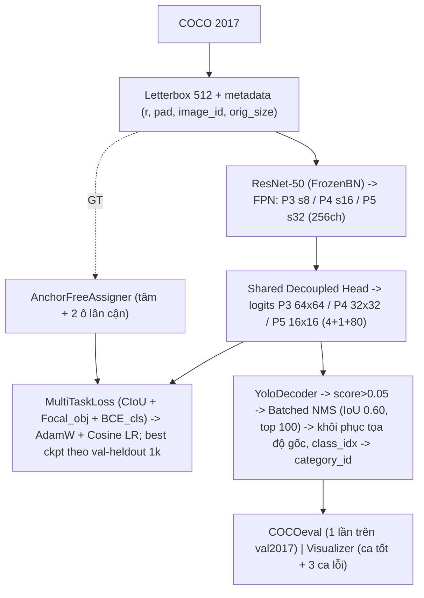

# ĐỊNH NGHĨA VÀ THIẾT KẾ HỆ THỐNG (DEFINE & DESIGN)
* **Dự án:** One-Stage Object Detector (YOLO-style Head, COCO 2017)  · **Giai đoạn:** thiết kế trước thực thi
## BỐI CẢNH VÀ GIẢ ĐỊNH
* **Môi trường:** Python 3.10+, PyTorch 2.0+, Torchvision 0.15+, pycocotools 2.0+. **Đầu vào:** $512 \times 512$ (cân bằng VRAM và khả năng bắt vật nhỏ). **Ổ đĩa:** ≥ 25 GB trống (xem 2.8).
* **Chia dữ liệu (zero leakage):** Train = 14.000 ảnh cố định ngẫu nhiên từ `train2017`. Val-heldout = 1.000 ảnh riêng từ `train2017` (không trùng train), dùng theo dõi loss, chỉnh siêu tham số, ablation, lưu `best_map.pth`. Test = 5.000 ảnh `val2017`, **chỉ chạy đúng 1 lần** cuối dự án để lấy số liệu báo cáo.
# PART 1: DEFINE
### 1.1 Project Name
* **YOLO-style One-Stage Object Detector with ResNet-50-FPN on COCO 2017:** detector một giai đoạn gồm ResNet-50, cổ FPN và Decoupled Head (kiểu YOLOX/YOLOv8) tự cài đặt.
### 1.2 Problem Statement
* **Đề bài gốc:** *Object Detection (YOLO-style Head on COCO). Goal: detect and classify multiple objects. Dataset: COCO 2017. Model: CNN backbone (ResNet/FPN) + Detection head. Task: Detection. Extension: compute mAP, AP50, visualize bounding boxes.* (https://cocodataset.org/)
* **Two-Stage** (Faster R-CNN): RPN đề xuất vùng → RoIAlign → phân loại/tinh chỉnh; chính xác nhưng chậm, cồng kềnh. **One-Stage** (YOLO, SSD, RetinaNet): dự đoán trực tiếp box và lớp tại mọi ô lưới; nhanh, gọn, nhưng phải xử lý mất cân bằng tiền cảnh/hậu cảnh (Focal Loss cho Objectness) và xung đột định vị/phân loại (Decoupled Head).
* **Input:** ảnh RGB bất kỳ → Letterbox $512 \times 512$. **Output:** boxes $[x_1,y_1,x_2,y_2]$ trên ảnh gốc, nhãn $0 \to 79$, $\text{score} = \sigma(t_{obj}) \times \sigma(t_{cls})$.
* **Thách thức:** (1) vật thể từ $<32^2$ đến $>96^2$ px; (2) mật độ cao, che khuất; (3) ô chứa vật thể $<0.1\%$ tổng vị trí; (4) 80 lớp, nhiều lớp con giống nhau (xe, động vật).
### 1.3 Target Users
* Giảng viên, sinh viên; làm tài liệu và mã mẫu tách rõ 4 khối: Model, Assigner, Loss, Decoder.
### 1.4 Input / Output Specification
| Thành phần | Input → Output | Shape / kiểu | Ghi chú |
| :--- | :--- | :--- | :--- |
| **Dataset** | path ảnh + COCO JSON → `image`, `target` | `image` $[3,512,512]$ F32; `boxes` $[N,4]$ F32; `labels` $[N]$ I64 | COCO $[x,y,w,h]$ → xyxy trên $512^2$. Metadata bắt buộc: `image_id`, `orig_size`, `scale_ratio` $r$, `pad_offsets`. |
| **Backbone+Neck** | $[B,3,512,512]$ → $\{P_3,P_4,P_5\}$ | $P_3$ $[B,256,64,64]$ (s8); $P_4$ $[B,256,32,32]$ (s16); $P_5$ $[B,256,16,16]$ (s32) | 256 channels cố định. |
| **Detection Head** | $\{P_3,P_4,P_5\}$ → logits mỗi tầng | `box` $[B,4,H,W]$; `obj` $[B,1,H,W]$; `cls` $[B,80,H,W]$ | Decoupled, chia sẻ trọng số giữa các tầng. |
| **Label Assigner** | GT boxes/labels + grid shapes → targets | `target_boxes` $[B,\sum A,4]$; `target_obj` $[B,\sum A,1]$; `target_cls` $[B,\sum A]$; `pos_mask` Bool | Tọa độ chia stride từng tầng; 3 ô dương (tâm + 2 lân cận); obj = 1.0 ô dương, 0.0 ô âm. |
| **Loss** | logits + targets → scalar | `loss_total/box/obj/cls` | CIoU chỉ trên `pos_mask`; Focal obj trên **mọi ô**; BCE cls chỉ trên ô dương. |
| **Decoder+NMS** | logits + metadata → dict mỗi ảnh | `boxes` $[K,4]$, `scores` $[K]$, `labels` $[K]$, $K \le 100$ | $\hat c=(grid+2\sigma(t)-0.5)s_l \in[-0.5,1.5]s_l$; $\hat w,\hat h=(2\sigma(t))^2\cdot4s_l \in[0,16s_l]$; Batched NMS theo lớp; khôi phục tọa độ gốc qua $r$, pad. |
| **COCO Evaluator** | dự đoán + GT JSON → metric dict | mAP@[.5:.95], AP50, AP75, AP_s/m/l, AR_1/10/100 | Ánh xạ $[0,79] \to [1,90]$, ghi đúng `image_id`. |
| **Visualizer** | ảnh, GT, Pred → `.png`/`.jpg` | — | GT xanh lá; Pred đỏ/xanh dương kèm nhãn + score. |
### 1.5 Core Features
1. **Data Pipeline:** tải COCO, subset 14k/1k, Letterbox 512, Random Flip, Color Jitter, giữ metadata, ánh xạ 2 chiều Category ID. 2. **Model:** ResNet-50 + FPN ($P_3,P_4,P_5$) + Decoupled YOLO Head tự viết.
3. **Label Assigner:** anchor-free center-grid kiểu YOLOv5 (ô tâm + 2 ô lân cận). 4. **Loss:** CIoU (box), Focal (obj, mọi ô), BCE (cls, ô dương).
5. **Training Engine:** AMP, Gradient Accumulation, Cosine LR, FrozenBN, chọn checkpoint theo val-heldout 1k. 6. **Decoder & Batched NMS:** offset $[-0.5,1.5]$, kích thước $[0,16s_l]$, score = obj × cls, ánh xạ về ảnh gốc.
7. **COCO Evaluation:** `pycocotools.cocoeval`. 8. **Visualizer & Error Analysis:** ca tốt và 3 ca lỗi điển hình.
* **Ngoài phạm vi:** không train toàn bộ 118k ảnh; không viết lại ResNet-50/FPN (dùng pretrained ImageNet-1K của `torchvision`); không đua SOTA (YOLOv8x, Co-DETR).
### 1.6 Technology Constraints
| Ràng buộc | Nội dung | Lý do | Nguồn gốc |
| :--- | :--- | :--- | :--- |
| Head | YOLO-style one-stage, không RPN/RoIAlign | Suy luận trực tiếp | Suy ra từ đề bài |
| Bounding Box | Anchor-free (center-based) | Bỏ K-means anchor; box ứng viên giảm $16.128 \to 5.376$ (3 lần), NMS nhanh hơn | Quyết định triển khai |
| Backbone / Neck | ResNet-50 / FPN $\{P_3,P_4,P_5\}$ | Đề yêu cầu "ResNet/FPN"; cân bằng độ sâu/tốc độ, bắt vật mọi kích thước | Quyết định triển khai / Từ đề bài |
| Ranh giới cài đặt | Thư viện: ResNet-50, FPN, NMS. Tự viết: Head, Assigner, Loss, Decoder | Nắm bản chất module lõi | Từ đề bài & lý thuyết |
| Loss | Box: CIoU (thay MSE/L1/Smooth L1). Obj: Focal trên mọi ô. Cls: BCE trên ô dương | CIoU tính tương quan 2D, tâm, tỷ lệ; Focal chế ngự mẫu âm dễ; BCE đa nhãn độc lập | Từ lý thuyết |
| Phân chia dữ liệu | 14k train / 1k val-heldout / 5k `val2017` | Chống rò rỉ; test 1 lần | Quyết định triển khai & đề bài |
| Đánh giá & ánh xạ | `pycocotools.cocoeval`; `category_id` (1–90) ↔ `class_idx` (0–79) | Chuẩn vàng mAP/AP50; xử lý 10 ID khuyết | Quyết định triển khai |
| Tài nguyên | 1 GPU ≤ 16GB, batch ≤ 16, $512^2$ | Tránh CUDA OOM | Giới hạn phần cứng |
### 1.7 Evaluation Criteria
#### 1. Cơ sở lý thuyết
* **Precision/Recall:** $\text{P}=\frac{TP}{TP+FP}$, $\text{R}=\frac{TP}{TP+FN}$. TP: đúng lớp, IoU ≥ ngưỡng; FP: sai lớp, IoU < ngưỡng hoặc box trùng GT đã gán; FN: GT bị bỏ sót.
* **PR Curve & AP:** quét confidence 1.0 → 0.0 để vẽ đường PR; AP = diện tích dưới đường PR, nội suy 101 điểm chuẩn COCO: $\text{AP}=\frac{1}{101}\sum_{r\in\{0,0.01,\dots,1\}}p_{\text{interp}}(r)$, $p_{\text{interp}}(r)=\max_{\tilde r\ge r}p(\tilde r)$.
* **mAP@[0.50:0.95]:** trung bình AP trên **80 lớp** và **10 ngưỡng IoU** (0.50 → 0.95, bước 0.05): $\frac{1}{80}\sum_{c}\frac{1}{10}\sum_{\text{IoU}}\text{AP}_{c,\text{IoU}}$.
* **AP50 / AP75:** AP tại IoU 0.50 / 0.75. **AP_s** (<$32^2$), **AP_m** ($32^2$–$96^2$), **AP_l** (>$96^2$). **AR_1/10/100:** độ phủ với tối đa 1/10/100 box/ảnh.
#### 2. Tiêu chí định tính
* **Ca tốt:** IoU ≥ 0.7, đúng lớp, score ≥ 0.70. **3 dạng ca lỗi:** (1) *Bỏ sót (FN):* vật nhỏ, bị che, thiếu sáng; (2) *Nhầm lớp:* đúng vị trí, sai lớp tương đồng (`cat`↔`dog`, `bus`↔`truck`); (3) *Lỗi NMS:* hai vật cùng lớp sát nhau bị gộp, hoặc một vật sinh 2 box do ngưỡng IoU chưa tối ưu.
#### 3. Mục tiêu hiệu năng (ước lượng định hướng, chưa kiểm chứng; hiệu chỉnh sau M5 và M6)
* *Bối cảnh:* Head khởi tạo ngẫu nhiên, chỉ 14k ảnh (~12% train COCO), 20 epochs, backbone đóng băng 3 epochs đầu. **Tối thiểu (pipeline đúng):** mAP ≥ 0.05–0.08; AP50 ≥ 0.10–0.15. **Kỳ vọng:** mAP 0.08–0.14; AP50 0.15–0.22. **Tốc độ:** ≥ 30 FPS ở FP16 trên T4/RTX 3060 (batch 1, gồm forward + Batched NMS).
# PART 2: DESIGN
### 2.1 System Architecture
#### 2.1.1 Sơ đồ tổng thể

#### 2.1.2 Thư viện vs. tự viết
* **`torchvision`:** `resnet50(weights=...)`, `ops.FeaturePyramidNetwork`, `ops.nms`. **Tự viết:** `YoloDecoupledHead` (chia sẻ trọng số), Focal Bias Init, `AnchorFreeAssigner` (dải $[-0.5,1.5]$), `MultiTaskLoss`, `YoloDecoder` (offset, kích thước $[0,16s_l]$, score, Batched NMS, khôi phục tọa độ).
#### 2.1.3 Cấu trúc Head và khởi tạo
* **Decoupled Head:** đầu vào chung $1\times1$ Conv→BN→SiLU (256→256). Mỗi nhánh: 2 lớp $3\times3$ Conv(256) → $1\times1$ Conv; Box → 4 ($t_x,t_y,t_w,t_h$); Obj → 1; Cls → 80.
* **Focal Bias (nhánh Obj):** $b=-\log\frac{1-\pi}{\pi}\approx-4.595$ ($\pi=0.01$), để $\sigma(b)\approx0.01$ ngay bước đầu, tránh bùng nổ loss.
### 2.2 Modules Specification
| Module | File | Chức năng | Input → Output |
| :--- | :--- | :--- | :--- |
| Downloader | `src/data/download_data.py` | Tải COCO, tách subset 14k/1k | URL → `data/coco/` |
| Dataset + Transforms | `src/data/dataset.py`, `transforms.py` | Đọc dữ liệu, Letterbox/Flip/Color Jitter, batch kèm metadata | path, JSON → `(images, targets)`, $r$, pad |
| Mapper | `src/data/category_mapper.py` | Ánh xạ 2 chiều ID (1–90 ↔ 0–79) | ID → ID |
| Backbone-FPN | `src/models/backbone_fpn.py` | ResNet-50 + FPN | $[B,3,512,512]$ → $\{P_3,P_4,P_5\}$ |
| YOLO Head + Detector | `src/models/yolo_head.py`, `detector.py` | Decoupled head; ghép detector, điều khiển train/eval | ảnh → logits (train) / boxes (eval) |
| Assigner | `src/core/assigner.py` | Gán GT vào 3 ô, offset $[-0.5,1.5]$ | GT, labels, grid → targets, `pos_mask` |
| Loss | `src/core/loss.py` | $5.0\mathcal L_{CIoU}+1.0\mathcal L_{Focal\_obj}+1.0\mathcal L_{BCE\_cls}$ | logits, targets → scalar |
| Decoder | `src/core/decoder.py` | Giải mã, score = obj×cls, Batched NMS | logits, metadata → `boxes/scores/labels` |
| Train Engine | `src/train.py` | Vòng train, AMP, chọn ckpt theo val-heldout | config, loaders → `.pth`, log |
| Evaluator | `src/evaluate.py` | COCOeval 1 lần trên `val2017` | ckpt, GT JSON → mAP, AP50, AP75 |
| Visualizer / Demo | `src/visualize.py`, `demo.py` | Vẽ GT vs Pred, ca tốt + 3 ca lỗi; suy luận 1 ảnh | ảnh, ckpt → `.png` |
| Utils | `src/utils/` | Box ops (CIoU, xywh↔xyxy), YAML, logger | — |
### 2.3 Folder Structure
```text
cw_nhom1/
├── configs/    base_config.yaml, dataset_coco_subset.yaml, model_resnet50_fpn.yaml   |  notebooks/: 01_data_exploration, 02_inference_inspection
├── data/coco/  annotations/, train2017/, val2017/, zips/, train_subset14k.json, val_heldout1k.json   (.gitignore)
├── docs/       DEFINE_AND_DESIGN, report, data, model, training, evaluation, demo, ai-usage, plan-progress-status, audit-log (.md, mỗi file < 200 dòng, RULES §16)
├── outputs/    checkpoints/ (best_map.pth, last_epoch.pth), evaluation_results/, logs/, visualizations/   (.gitignore)
├── src/        core/ (assigner, decoder, loss), data/ (category_mapper, dataset, download_data, transforms),
│               models/ (backbone_fpn, detector, yolo_head), utils/ (box_ops, config, logger),
│               train.py, evaluate.py (cờ --final), visualize.py, demo.py
├── tests/      test_assigner, test_box_ops, test_category_mapper, test_dataset, test_data_split, test_decoder,
│               test_loss, test_model_forward, test_overfit, test_transforms, verify_split
└── README.md, requirements.txt, RULES.md, .gitignore
```
### 2.4 Data Flow
* **Huấn luyện:** Ảnh + JSON → Letterbox 512 → Category Mapping → ResNet-50 + FPN (FrozenBN) → Shared Head → logits. GT boxes → Assigner (3 ô dương) → targets. MultiTaskLoss (5×CIoU + 1×Focal_obj + 1×BCE_cls) → AdamW + Cosine LR.
* **Suy luận & Đánh giá:** Ảnh test → Letterbox 512 → Forward → Decoder (tâm $[-0.5,1.5]s$, kích thước $[0,16s]$) → lọc score $>0.05$ → Batched NMS (IoU 0.60, top 100) → bỏ pad, chia $r$ về ảnh gốc → Category ID → `COCOeval` / Visualizer.
#### 2.4.3 Quy tắc chuyển hệ tọa độ
1. **COCO → Letterbox:** $x_1=x_{min}$, $x_2=x_{min}+w$ (tương tự $y$); $r=\min(512/H,512/W)$; $\text{pad}_w=(512-W r)/2$, $\text{pad}_h=(512-H r)/2$; $x'=x\cdot r+\text{pad}_w$, $y'=y\cdot r+\text{pad}_h$.
2. **Letterbox → lưới FPN (Assigner), tầng $l$ stride $s_l$:** tâm $c=(x_1'+x_2')/2$ (tương tự $y$); $g=c/s_l$; ô chứa tâm $(i,j)=(\lfloor g_x\rfloor,\lfloor g_y\rfloor)$; phần dư $\delta_x=g_x-i$, $\delta_y=g_y-j\in[0,1)$.
   * **3 ô dương:** ô $(i,j)$ + [$\delta_x<0.5$ và $i>0$: $(i-1,j)$; $\delta_x\ge0.5$ và $i<W_l-1$: $(i+1,j)$] + [$\delta_y<0.5$ và $j>0$: $(i,j-1)$; $\delta_y\ge0.5$ và $j<H_l-1$: $(i,j+1)$]. Target obj = 1.0 cho 3 ô này, 0.0 cho các ô còn lại.
3. **Logits → box (Decoder):** $\hat c_x=(i+2\sigma(t_x)-0.5)s_l$, $\hat c_y=(j+2\sigma(t_y)-0.5)s_l$; $\hat w=(2\sigma(t_w))^2\cdot4s_l$, $\hat h=(2\sigma(t_h))^2\cdot4s_l$. Dải kích thước: $P_3$ $[0,128]$ px (vật $\sqrt{wh}<64$); $P_4$ $[0,256]$ (64–168); $P_5$ $[0,512]$ (≥168, phủ cả ảnh).
4. **Về ảnh gốc:** $\hat x_{1,2}=(\hat c_x\mp\hat w/2-\text{pad}_w)/r$, $\hat y_{1,2}=(\hat c_y\mp\hat h/2-\text{pad}_h)/r$; clip vào $[0,W_{orig}]$, $[0,H_{orig}]$.
#### 2.4.4 Ánh xạ danh mục
* COCO có 80 lớp, ID 1–90; 10 ID khuyết `[12,26,29,30,45,66,68,69,71,83]`. `category_id_to_class_idx`: → $[0,79]$ khi nạp dữ liệu; `class_idx_to_category_id`: $[0,79]\to[1,90]$ khi xuất JSON cho `COCOeval`.
### 2.5 Interfaces / APIs
#### 2.5.1 Chữ ký hàm chính
```python
COCODataset(root, annotation_file, img_size=512, transforms=None, is_train=True)  # item: image [3,512,512]; target {boxes xyxy, labels, image_id, orig_size, scale_ratio, pad_offsets}
build_detector(num_classes=80, pretrained_backbone=True, trainable_backbone_layers=3)  # ResNet-50(FrozenBN)+FPN+Head; head.forward -> {'P3': {'box','obj','cls'}, ...}
assign_targets(gt_boxes, gt_labels, fpn_strides=[8,16,32], grid_shapes=[(64,64),(32,32),(16,16)])  # 3 ô, obj 1.0/0.0
compute_loss(preds, targets, lambda_box=5.0, lambda_obj=1.0, lambda_cls=1.0) -> (loss, dict)  # CIoU/BCE: ô dương; Focal: mọi ô
decode_predictions(raw_preds, strides=[8,16,32]) -> boxes, obj, cls  # offset [-0.5,1.5], wh [0,16s]
nms_postprocess(boxes, obj, cls, metadata, conf_threshold=0.05, nms_iou_threshold=0.60, max_detections=100)  # score=σ(obj)σ(cls); batched NMS (boxes+class_id*4096); khôi phục tọa độ qua scale_ratio, pad_offsets
train_one_epoch(model, optimizer, scaler, dataloader, device, epoch, loss_fn)  # AMP + gradient clipping
evaluate_coco(model, dataloader, coco_gt, device, output_json_path)  # JSON COCO + COCOeval; draw_detections(image, boxes, labels, scores, class_names, color)
```
#### 2.5.2 CLI
* `python -m src.train --config configs/base_config.yaml --batch-size 16 --epochs 20 --lr 0.001 --seed 42` (đánh giá định kỳ trên `val_heldout1k.json`, lưu `best_map.pth`); `python -m src.evaluate --checkpoint outputs/checkpoints/best_map.pth --dataset val2017 --final --conf-thresh 0.05 --nms-thresh 0.60` (COCOeval 1 lần trên `val2017`).
* `python -m src.visualize --predictions outputs/evaluation_results/predictions_heldout.json --num-samples 15 --output-dir outputs/visualizations/eval_samples --conf-thresh 0.10` (GT vs Pred, ca tốt + 3 ca lỗi); `python -m src.demo --image <ảnh> --checkpoint outputs/checkpoints/best_map.pth --output-dir outputs/visualizations/demo` (dự đoán 1 ảnh).
### 2.6 Milestones & Project Status
| Mốc | Deliverables | Tiêu chí hoàn thành |
| :--- | :--- | :--- |
| **M0** Setup & Data Split | Môi trường, script tải, subset 14k/1k | Có `train_subset14k.json`, `val_heldout1k.json`, `instances_val2017.json` (5k) |
| **M1** Dataset & Metadata | `COCODataset`, `transforms.py`, `category_mapper.py` | Test mapping 80 lớp 100%; batch $[B,3,512,512]$ kèm $r$, pad, image_id |
| **M2** Model | ResNet-50 (FrozenBN) + FPN + Head | Forward GPU đúng shape $P_3,P_4,P_5$, không tràn VRAM |
| **M3** Assigner & Loss | `assign_targets`, `compute_loss` | Overfit 10 ảnh: loss giảm mượt về ~0, recall ≈ 1.0 |
| **M4** Training Engine | Vòng train, AMP, grad clip, chọn ckpt | Chạy 1 epoch không lỗi; lưu `best_map.pth` theo val-heldout |
| **M5** Decoder & Pilot | `YoloDecoder`, Batched NMS, COCOeval | Smoke test 100 ảnh val-heldout; JSON hợp lệ; COCOeval không crash; hiệu chỉnh mục tiêu mAP |
| **M6** Baseline | Train 20 epochs trên 14k | Có `best_map.pth`; log loss và mAP val-heldout |
| **M7** Ablation | 3 thực nghiệm (5–10 epochs/bài) | Bảng so sánh trên val-heldout 1k (không dùng `val2017`) |
| **M8** Final Eval & Viz | Đánh giá 1 lần `val2017`; `visualize.py` | Bảng metric chính thức; ≥ 15 ảnh; phân tích đủ 3 ca lỗi |
| **M9** Đóng gói & Docs | Dọn code, kiểm tra CLI, README | Chạy được train/evaluate/demo; code chuẩn PEP8 |
### 2.7 Key Design Decisions
#### 1. Anchor-Based vs Anchor-Free
* **Anchor-Based (YOLOv3/v4, Faster R-CNN):** $k$ anchor $(w_a,h_a)$ cố định từ K-means (3 anchor × 3 tầng); mô hình học độ lệch $\Delta x,\Delta y,\Delta w,\Delta h$. Hạn chế: $3\times(64^2+32^2+16^2)=16.128$ box; phụ thuộc dữ liệu, kém với tỷ lệ khung bất thường.
* **Anchor-Free (center-based, được chọn):** mỗi ô lưới là điểm tham chiếu, dự đoán trực tiếp tâm và kích thước theo stride. Không cần siêu tham số anchor; chỉ $1\times(64^2+32^2+16^2)=5.376$ box (giảm đúng 3 lần), tiết kiệm GPU, NMS nhanh, code gọn.
#### 2. Chuỗi tiến hóa loss box: IoU → GIoU → DIoU → CIoU
* **IoU:** $1-\text{IoU}$; gradient bằng 0 khi 2 box không giao. **GIoU:** $1-\text{IoU}+\frac{|C\setminus(A\cup B)|}{|C|}$ ($C$: hộp bao nhỏ nhất); xử lý IoU=0 nhưng hội tụ chậm khi box nằm trọn trong box kia. **DIoU:** $1-\text{IoU}+\frac{\rho^2(b,b^{gt})}{c^2}$; tối ưu trực tiếp khoảng cách 2 tâm ($c$: đường chéo hộp bao).
* **CIoU (chọn):** thêm nhất quán tỷ lệ khung: $\mathcal L_{CIoU}=1-\text{IoU}+\frac{\rho^2}{c^2}+\alpha v$, $v=\frac{4}{\pi^2}\big(\arctan\frac{w^{gt}}{h^{gt}}-\arctan\frac wh\big)^2$, $\alpha=\frac{v}{(1-\text{IoU})+v}$.
#### 3. Phạm vi tính Loss và lý do chọn Focal
* **Objectness (Focal, mọi ô):** dự đoán trên 5.376 ô, >99.9% là âm tính; Focal triệt tiêu gradient từ mẫu âm dễ: $\mathcal L_{Focal\_obj}=-\alpha_t(1-p_{obj})^\gamma\log p_{obj}$ ($\gamma=2.0$, $\alpha=0.25$). **Class (BCE, ô dương):** chỉ tính trên `pos_mask == True`, BCE đa nhãn 80 lớp, không chịu áp lực mất cân bằng âm/dương.
* **Tổng:** $\mathcal L_{total}=5.0\,\mathcal L_{CIoU}+1.0\,\mathcal L_{Focal\_obj}+1.0\,\mathcal L_{BCE\_cls}$
#### 4. Label Assignment: ô tâm + 2 ô lân cận
* **Chọn tầng theo $\sqrt{w\cdot h}$:** $<64$ px → $P_3$ (s=8, dải $[0,128]$); $64\le\cdot<168$ → $P_4$ (s=16, dải $[0,256]$); $\ge168$ → $P_5$ (s=32, dải $[0,512]$). Ngưỡng 64 là trung điểm dải $P_3$ ($8\times s_3$); 168 ($10.5\times s_4$) là điểm chuyển tối ưu $P_4\to P_5$, giữ mọi kích thước trong vùng không bão hòa của Sigmoid.
* **Ô dương:** ô chứa tâm + 2 ô lân cận gần nhất theo $(\delta_x,\delta_y)$, khớp công thức Decoder (miền $[-0.5,1.5]s_l$). Target obj: 1.0 (hard) cho 3 ô, 0.0 cho các ô còn lại.
#### 5. Đóng băng Backbone và FrozenBN
* ResNet-50 `requires_grad=False` 3 epochs đầu (ổn định Head ngẫu nhiên, tiết kiệm VRAM); từ epoch 4 mở khóa Layers 2–4, fine-tune với Cosine LR. **FrozenBatchNorm2d:** giữ running mean/var của ImageNet, tránh batch nhỏ ($\le16$) làm hỏng chuẩn hóa.
#### 6. Ablation Study (M7): 5–10 epochs/bài, chỉ đánh giá trên val-heldout 1k (không dùng `val2017`)
1. **Loss box:** Smooth L1 vs CIoU. 2. **Loss objectness:** BCE chuẩn vs Focal (chế ngự mẫu âm). 3. **Cổ mạng:** có FPN $\{P_3,P_4,P_5\}$ vs không FPN (chỉ $P_5$/Layer 4) để chứng minh vai trò $P_3$ với $AP_s$.
### 2.8 Known Risks & Limitations
| Rủi ro | Mức độ | Nguyên nhân | Giảm thiểu |
| :--- | :--- | :--- | :--- |
| Dung lượng COCO (~18 GB) | Cao | `train2017.zip` ~18 GB, giải nén >25 GB | `download_data.py` 2 chế độ: (A) tải zip nếu đủ ổ; (B) tải qua URL đúng 15k ảnh (~2.3 GB) |
| CUDA OOM | Cao | Batch/ảnh quá lớn | Ảnh $512^2$; AMP; Gradient Accumulation; FrozenBN |
| Bão hòa gradient (mất cân bằng) | Cao | Ô background áp đảo | Focal ($\gamma=2.0$); bias init $b=-4.595$ ($\pi=0.01$) |
| Lỗi ánh xạ Category ID | Rất cao | 10 ID khuyết, nhầm ID thì mAP về 0 | `test_category_mapper.py` kiểm tra 2 chiều trước train/eval |
| Sai hệ tọa độ & metadata | Cao | Thiếu $r$, pad, sai offset decoder | Đồng bộ offset $[-0.5,1.5]$, $w,h\in[0,16s]$; metadata trong Dataset |
| Rò rỉ mềm | Rất cao | Chọn ckpt/chạy ablation trên `val2017` | Dùng val-heldout 1k; chỉ test 1 lần trên `val2017` |
| Hội tụ chậm / phá weights | Trung bình | LR ban đầu quá cao | Warmup 1–2 epochs; Cosine LR; clip gradient 10.0 |
| Bỏ sót vật nhỏ ($<32^2$) | Trung bình | Feature map bị giảm phân giải | Dùng $P_3$ (s8); $\lambda_{box}=5.0$ |
## BẢNG ĐỐI CHIẾU ĐỀ BÀI VÀ THIẾT KẾ (MAPPING MATRIX)
| Yêu cầu đề bài | Mục thiết kế | Nội dung | Nguồn gốc (Quy tắc 14) |
| :--- | :--- | :--- | :--- |
| Detect & classify multiple objects | 1.2, 1.4, 2.1 | Nhận diện đồng thời nhiều vật, 80 lớp | Từ đề bài |
| Dataset: COCO 2017 | 1.2, 1.4, 1.6, 2.2 | Train 14k, val-heldout 1k, test 5k `val2017` | Từ đề bài |
| Model: ResNet Backbone / FPN Neck | 1.6, 2.1, 2.2 | ResNet-50 (quyết định triển khai) / FPN $\{P_3,P_4,P_5\}$ 256 ch (từ đề bài) | Quyết định triển khai / Từ đề bài |
| Model: YOLO-style Head | 1.6, 2.1, 2.2, 2.7 | Decoupled Head tự viết, chia sẻ trọng số | Từ đề bài |
| Task: One-stage Detection | 1.1, 1.2, 1.6, 2.1 | Một giai đoạn; loại trừ two-stage/RPN/RoIAlign | Suy ra từ đề bài |
| Extension: mAP, AP50 / Visualize boxes | 1.4, 1.7, 2.2, 2.5 | `pycocotools` (mAP@[.5:.95], AP50, AP75, AP_s/m/l); `visualize.py` (GT vs Pred, ca tốt + 3 ca lỗi) | Quyết định triển khai / Từ đề bài |
## CHECKLIST RÀNG BUỘC (CONSTRAINTS VERIFICATION)
* [x] **1. One-Stage YOLO Head:** dự đoán trực tiếp trên lưới; so sánh ưu/nhược vs two-stage; không RPN/RoIAlign (1.2, 1.6, 2.1, 2.7). **2. ResNet-50 → FPN → Head:** FrozenBN, $P_3,P_4,P_5$ (s8/16/32), Head chia sẻ trọng số (1.6, 2.1).
* [x] **3. Tự viết vs thư viện:** ResNet-50, FPN, NMS từ torchvision; Head, Assigner, Loss, Decoder tự viết (2.1.2). **4. Đủ 4 thành phần:** Model, Assigner, Loss, Decoder (1.4, 2.2, 2.3).
* [x] **5. Anchor-Free vs Anchor-Based:** so sánh khái niệm; giảm đúng 3 lần số box (1.6, 2.7.1). **6. Loss:** chuỗi IoU→GIoU→DIoU→CIoU; công thức CIoU; Focal (obj); BCE (cls); $L_{total}$ (2.7.2, 2.7.3).
* [x] **7. Đồng bộ Assigner–Decoder:** ô tâm + 2 lân cận; offset $[-0.5,1.5]$; kích thước $[0,16s_l]$ (1.4, 2.4.3, 2.7.4). **8. Hậu xử lý & COCOeval:** metadata đủ; score = obj×cls; Batched NMS theo lớp; khôi phục tọa độ (1.4, 2.4.3, 2.5.1).
* [x] **9. Zero Leakage:** train 14k; ckpt + ablation trên val-heldout 1k; `val2017` đúng 1 lần (Bối cảnh, 1.6, 2.6, 2.8). **10. Lý thuyết đánh giá:** Precision, Recall, PR, AP (101 điểm); mAP = TB 80 lớp × 10 ngưỡng IoU (1.7).
* [x] **11. Ánh xạ Category ID 2 chiều:** 1–90 ↔ 0–79, nêu rõ nơi dùng (1.4, 2.4.4). **12. Trực quan hóa & phân tích lỗi:** ca tốt (score ≥ 0.7, IoU ≥ 0.7) + 3 ca lỗi (1.7, 2.1, 2.6).
* [x] **13. Mục tiêu hiệu năng & Ablation:** mục tiêu định hướng, hiệu chỉnh sau pilot; M7 cho 3 ablation (1.7, 2.6, 2.7.6). **14. Nguồn gốc ràng buộc:** Từ đề bài / Từ lý thuyết / Quyết định triển khai / Suy ra từ đề bài / Giới hạn phần cứng (1.6, Mapping Matrix).
