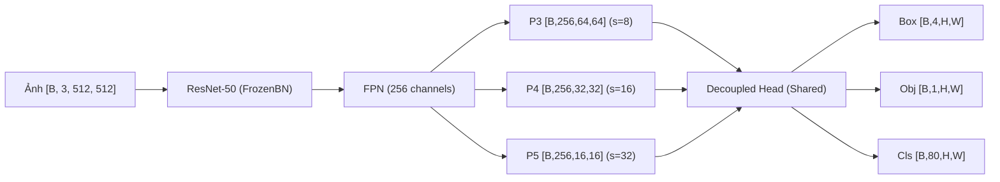

# TÀI LIỆU KIẾN TRÚC MÔ HÌNH (MODEL ARCHITECTURE)

* **Module liên quan:** [`src/models/backbone_fpn.py`](file:///d:/cw/src/models/backbone_fpn.py), [`src/models/yolo_head.py`](file:///d:/cw/src/models/yolo_head.py), [`src/models/detector.py`](file:///d:/cw/src/models/detector.py)
* **Cấu hình:** [`configs/model_resnet50_fpn.yaml`](file:///d:/cw/configs/model_resnet50_fpn.yaml)
* **Kiểm thử:** `tests/test_model_forward.py` (4/4 passed)

---

## 1. TỔNG QUAN KIẾN TRÚC (RESNET-50-FPN + DECOUPLED HEAD)

Mô hình là detector một giai đoạn (one-stage), không dùng Anchor box (Anchor-free), gồm 3 khối chính:
1. **Backbone:** ResNet-50 tiền huấn luyện ImageNet (`ResNet50_Weights.DEFAULT`) với `FrozenBatchNorm2d`.
2. **Neck:** Feature Pyramid Network (FPN) trích xuất 3 bản đồ đặc trưng đa tỷ lệ `{P3, P4, P5}`.
3. **Head:** Decoupled YOLO Head tự cài đặt theo phong cách YOLOX/YOLOv8, chia sẻ trọng số tích chập giữa 3 tầng FPN.

---

## 2. BACKBONE VÀ NECK (`backbone_fpn.py`)

### 2.1 Tại sao dùng `FrozenBatchNorm2d` thay vì `BatchNorm2d`?
- Khi huấn luyện Object Detection với ảnh kích thước lớn ($512 \times 512$), batch size thường nhỏ ($B \in [4, 16]$). `BatchNorm2d` thông thường sẽ tính `mean`/`var` trên batch nhỏ đó gây nhiễu và làm hỏng thống kê chuẩn hóa của ResNet-50 pretrained.
- `FrozenBatchNorm2d` giữ cố định `running_mean`, `running_var`, `weight`, `bias` từ ImageNet và luôn tắt gradient (`requires_grad = False`), giúp huấn luyện ổn định ở mọi kích thước batch.

### 2.2 Chi tiết các tầng đặc trưng FPN
| Tầng nguồn ResNet | Kênh vào | Tầng FPN | Stride ($s_l$) | Output Shape | Số ô lưới | Vật thể mục tiêu |
|:---|:---:|:---|:---:|:---|:---:|:---|
| `layer2` | 512 | `P3` | 8 | `[B, 256, 64, 64]` | 4.096 | Vật nhỏ ($\sqrt{wh} < 64$ px) |
| `layer3` | 1024 | `P4` | 16 | `[B, 256, 32, 32]` | 1.024 | Vật trung bình ($64 \le \sqrt{wh} < 168$ px) |
| `layer4` | 2048 | `P5` | 32 | `[B, 256, 16, 16]` | 256 | Vật lớn ($\sqrt{wh} \ge 168$ px) |
| **Tổng cộng** | — | **3 tầng** | — | — | **5.376** | **Anchor-free (1 dự đoán/ô)** |

### 2.3 Chiến lược đóng băng / mở khóa (Freezing Strategy)
- **Epoch 1–3 (`freeze_backbone()`):** Đóng băng toàn bộ ResNet-50, chỉ huấn luyện FPN + Head (~6.26M tham số) để các lớp Head khởi tạo ngẫu nhiên ổn định trước, tránh phá hỏng trọng số pretrained.
- **Từ Epoch 4 (`unfreeze_backbone(trainable_layers=3)`):** Mở khóa `layer2`, `layer3`, `layer4` (~29.49M tham số trainable) để tinh chỉnh toàn mạng theo đặc trưng COCO.

---

## 3. DECOUPLED YOLO HEAD (`yolo_head.py`)

### 3.1 Tách biệt không gian đặc trưng (Decoupled Design)
Tác vụ định vị (cần nhạy với biên, hình học) và phân loại (cần bất biến dịch chuyển, ngữ nghĩa) thường xung đột nếu dùng chung 1 nhánh. Kiến trúc tách thành 3 nhánh sau lớp stem $1 \times 1$ (256 $\to$ 256):
- **Box Branch:** 2 lớp Conv $3 \times 3$ (256 ch) $\to$ Conv $1 \times 1$ xuất 4 giá trị $(t_x, t_y, t_w, t_h)$.
- **Objectness Branch:** 2 lớp Conv $3 \times 3$ (256 ch) $\to$ Conv $1 \times 1$ xuất 1 logit đánh giá xác suất có vật thể.
- **Classification Branch:** 2 lớp Conv $3 \times 3$ (256 ch) $\to$ Conv $1 \times 1$ xuất 80 logits tương ứng 80 lớp COCO.

### 3.2 Chia sẻ trọng số, tách BatchNorm và Focal Bias
- **Shared Weights + Per-level BN:** Trọng số Conv được dùng chung qua `P3, P4, P5` để giảm số tham số, nhưng mỗi tầng có lớp `BatchNorm2d` riêng (`bns`) nhằm tránh lệch phân phối kích hoạt giữa các độ phân giải.
- **Focal Bias Initialization:** Nhánh Objectness khởi tạo bias âm:
  $$b = -\log\left(\frac{1 - \pi}{\pi}\right) \approx -4.595 \quad (\pi = 0.01)$$
  giúp xác suất ban đầu $\sigma(b) \approx 0.01$, ngăn bùng nổ gradient từ >99% ô nền ngay bước đầu.
- **Khởi tạo lớp chiếu:** Trọng số Conv đầu ra khởi tạo phân phối chuẩn `std=0.01`.

---

## 4. THỐNG KÊ THAM SỐ MÔ HÌNH (`build_detector`)

| Trạng thái | Tham số tổng | Tham số Trainable | Tham số Frozen |
|:---|---:|---:|---:|
| **Epoch 1–3 (Freeze Backbone)** | 29,713,429 | 6,258,517 (21.1%) | 23,454,912 (78.9%) |
| **Epoch 4+ (Unfreeze Layers 2–4)** | 29,713,429 | 29,491,029 (99.3%) | 222,400 (0.7% — conv1/layer1/FrozenBN) |
