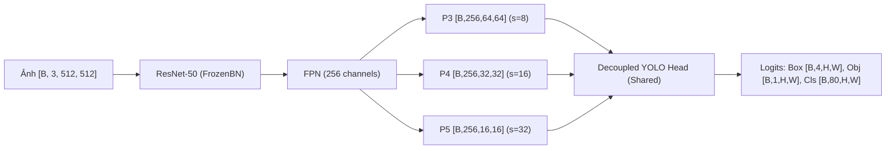

# TÀI LIỆU KIẾN TRÚC MÔ HÌNH (MODEL ARCHITECTURE)

* **Module liên quan:** `src/models/` (`backbone_fpn.py`, `yolo_head.py`, `detector.py`)
* **Kiểm thử:** `tests/test_model_forward.py` (4/4 passed)

---

## 1. TỔNG QUAN KIẾN TRÚC (RESNET-50-FPN + DECOUPLED HEAD)

Mô hình là detector một giai đoạn (one-stage), không sử dụng Anchor box (Anchor-free), gồm 3 khối chính:
1. **Backbone:** ResNet-50 nạp trọng số tiền huấn luyện ImageNet (`ResNet50_Weights.DEFAULT`).
2. **Neck:** Feature Pyramid Network (FPN) kết nối lateral và top-down.
3. **Head:** Decoupled YOLO Head tự code theo phong cách YOLOX/YOLOv8 với trọng số chia sẻ giữa các tầng.

---

## 2. BACKBONE VÀ NECK (`backbone_fpn.py`)

### 2.1 FrozenBatchNorm2d
- Thay thế toàn bộ các lớp `BatchNorm2d` bằng `FrozenBatchNorm2d`.
- Giữ cố định `running_mean`, `running_var`, `weight`, `bias` và không cập nhật gradient (`requires_grad = False`).
- Giải quyết triệt để lỗi bất ổn định thống kê batch khi huấn luyện với batch size nhỏ trên GPU đơn.

### 2.2 Feature Pyramid Network (FPN)
- Trích xuất đặc trưng từ 3 khối cuối của ResNet-50:
  - `layer2` (stride 8) $\to P_3: [B, 256, 64, 64]$ (phát hiện vật thể nhỏ).
  - `layer3` (stride 16) $\to P_4: [B, 256, 32, 32]$ (phát hiện vật thể trung bình).
  - `layer4` (stride 32) $\to P_5: [B, 256, 16, 16]$ (phát hiện vật thể lớn).
- Cố định số kênh đặc trưng ở tất cả các tầng đầu ra là 256.

### 2.3 Chiến lược đóng băng / mở khóa (Freezing Strategy)
- **3 Epoch đầu:** Gọi `freeze_backbone()` — đóng băng toàn bộ ResNet-50, chỉ huấn luyện FPN và Detection Head để ổn định phân phối đặc trưng.
- **Từ Epoch 4 trở đi:** Gọi `unfreeze_backbone(trainable_layers=3)` — mở khóa các tầng `layer2`, `layer3`, `layer4` để fine-tune toàn diện.

---

## 3. DECOUPLED YOLO HEAD (`yolo_head.py`)

### 3.1 Tách biệt không gian đặc trưng (Decoupled Design)
Thay vì dùng 1 nhánh chung như YOLOv3/v5 ban đầu, kiến trúc tách thành 3 nhánh riêng biệt để tránh xung đột giữa tác vụ định vị (hồi quy) và phân loại:
- **Nhánh Hộp (Box Branch):** 2 lớp Conv $3 \times 3$ (256 kênh) + 1 lớp Conv $1 \times 1$ đưa ra 4 giá trị $t_x, t_y, t_w, t_h$.
- **Nhánh Vật thể (Objectness Branch):** 2 lớp Conv $3 \times 3$ (256 kênh) + 1 lớp Conv $1 \times 1$ đưa ra 1 logit objectness.
- **Nhánh Phân loại (Classification Branch):** 2 lớp Conv $3 \times 3$ (256 kênh) + 1 lớp Conv $1 \times 1$ đưa ra 80 logits xác suất lớp.

### 3.2 Chia sẻ trọng số và Khởi tạo Focal Bias
- Trọng số các lớp tích chập được chia sẻ giữa các tầng $P_3, P_4, P_5$ (shared weights).
- **Focal Bias Initialization:** Nhánh Objectness được khởi tạo bias âm ban đầu:
  $$b = -\log\left(\frac{1 - \pi}{\pi}\right) \approx -4.595 \quad (\text{với } \pi = 0.01)$$
  Giúp ngăn chặn bùng nổ gradient từ hàng nghìn ô lưới hậu cảnh (negative cells) trong những bước huấn luyện đầu tiên.
